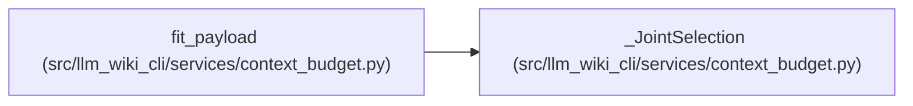

# _JointSelection

**Location:** `src/llm_wiki_cli/services/context_budget.py:137`
**Kind:** Class
**Bases:** —
**Module:** [context_budget](../modules/context_budget.md)

## Description

Spend one budget across whole native groups and source detail.

Relevance wins before currentness. Within the same rank, optional native
relationships and source detail yield before concepts and whole sources.
A useful source and native group remain when available; explicit target
enrichment and its selected coordinates are never reduced.

## Attributes

*No annotated attributes found.*

## Methods

| Method | Signature | Decorators | Description |
|--------|-----------|------------|-------------|
| `__init__` | `(payload, request, freshness)` | — | — |
| `rank` | `(path)` | — | — |
| `reduce` | `()` | — | — |

## Relationships

<!-- Auto-generated relationship summary. Do not edit by hand. -->

### Summary

| Module | Methods | Attributes |
|---|---:|---|
| [context_budget](../modules/context_budget.md) | 3 | — |

### References

| Reference | Kind | Source | Call sites |
|---|---|---|---:|
| `fit_payload` | call | [context_budget](../modules/context_budget.md) | 1 |
