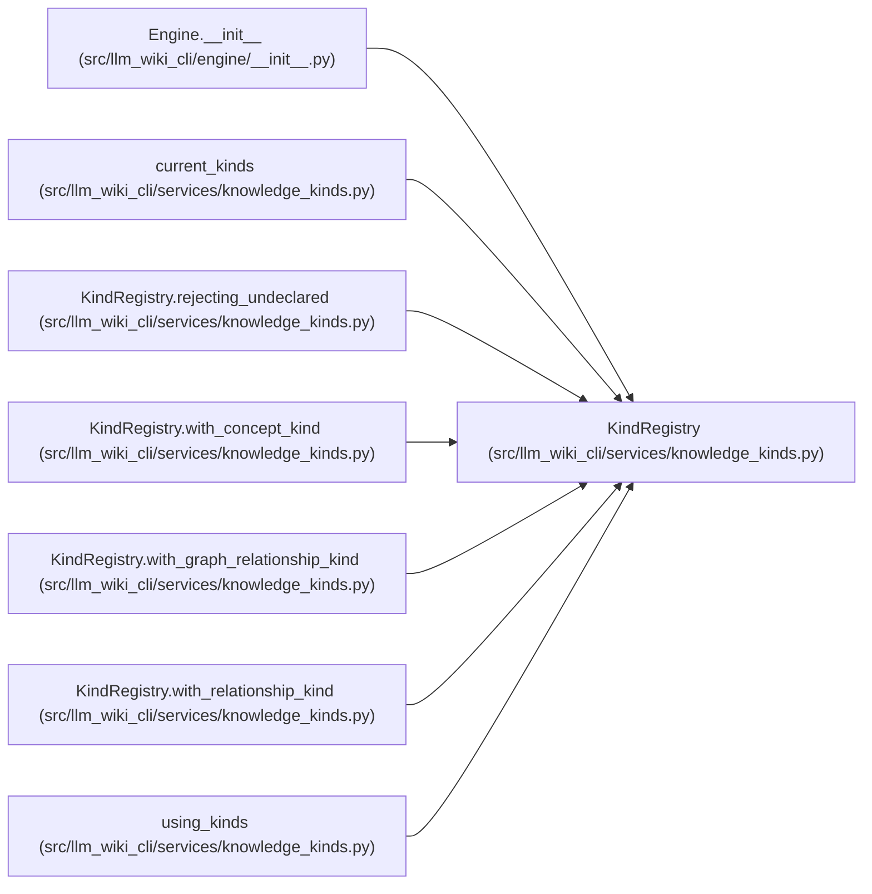

# KindRegistry

**Location:** `src/llm_wiki_cli/services/knowledge_kinds.py:144`
**Kind:** Class
**Bases:** —
**Module:** [knowledge_kinds](../modules/knowledge_kinds.md)

**Decorators:** `@dataclass(frozen=True)`

## Description

Declared concept, relationship and typed-graph edge kinds.

## Attributes

| Name | Type | Default | Description |
|------|------|---------|-------------|
| `concept_kinds` | `tuple[ConceptKindSpec, ...]` | `_BUILTIN_CONCEPT_SPECS` | — |
| `relationship_kinds` | `tuple[RelationshipKindSpec, ...]` | `_BUILTIN_RELATIONSHIP_SPECS` | — |
| `graph_relationship_kinds` | `tuple[RelationshipKindSpec, ...]` | `_BUILTIN_GRAPH_SPECS` | — |
| `undeclared` | `UndeclaredPolicy` | `'accept'` | — |

## Methods

| Method | Signature | Decorators | Description |
|--------|-----------|------------|-------------|
| `__post_init__` | `() -> None` | — | — |
| `page_kinds` | `() -> tuple[PageKind, ...]` | `@property` | The page kinds the v1 format defines; they cannot be extended. |
| `with_concept_kind` | `(spec: ConceptKindSpec) -> KindRegistry` | — | A copy of this registry that also declares ``spec``. |
| `with_relationship_kind` | `(spec: RelationshipKindSpec) -> KindRegistry` | — | A copy of this registry that also declares relationship kind ``spec``. |
| `with_graph_relationship_kind` | `(spec: RelationshipKindSpec) -> KindRegistry` | — | A copy of this registry that also declares typed-graph edge kind ``spec``. |
| `rejecting_undeclared` | `() -> KindRegistry` | — | A copy of this registry that refuses custom kinds it does not declare. |
| `describe` | `() -> dict[str, Any]` | — | A JSON-ready summary of the declared kinds. |
| `identity` | `() -> tuple` | — | A value that changes whenever what this registry accepts may change. |
| `check` | `(model: KnowledgeIndex) -> None` | — | Refuse custom kinds in ``model`` that break this registry's rules. |
| `_require_declared` | `(kind: str, declared: set[str], path: str, family: str) -> None` | — | — |
| `_check_concept` | `(concept: ConceptRecord, spec: ConceptKindSpec \| None, path: str) -> None` | — | — |

## Relationships

<!-- Auto-generated relationship summary. Do not edit by hand. -->

### Summary

| Module | Methods | Attributes |
|---|---:|---|
| [knowledge_kinds](../modules/knowledge_kinds.md) | 11 | `concept_kinds`, `graph_relationship_kinds`, `relationship_kinds`, `undeclared` |

### References

| Reference | Kind | Source | Call sites |
|---|---|---|---:|
| `Engine.__init__` | type_reference | [engine___init__](../modules/engine___init__.md) | — |
| `current_kinds` | type_reference | [knowledge_kinds](../modules/knowledge_kinds.md) | — |
| `KindRegistry.rejecting_undeclared` | type_reference | [knowledge_kinds](../modules/knowledge_kinds.md) | — |
| `KindRegistry.with_concept_kind` | type_reference | [knowledge_kinds](../modules/knowledge_kinds.md) | — |
| `KindRegistry.with_graph_relationship_kind` | type_reference | [knowledge_kinds](../modules/knowledge_kinds.md) | — |
| `KindRegistry.with_relationship_kind` | type_reference | [knowledge_kinds](../modules/knowledge_kinds.md) | — |
| `using_kinds` | type_reference | [knowledge_kinds](../modules/knowledge_kinds.md) | — |
