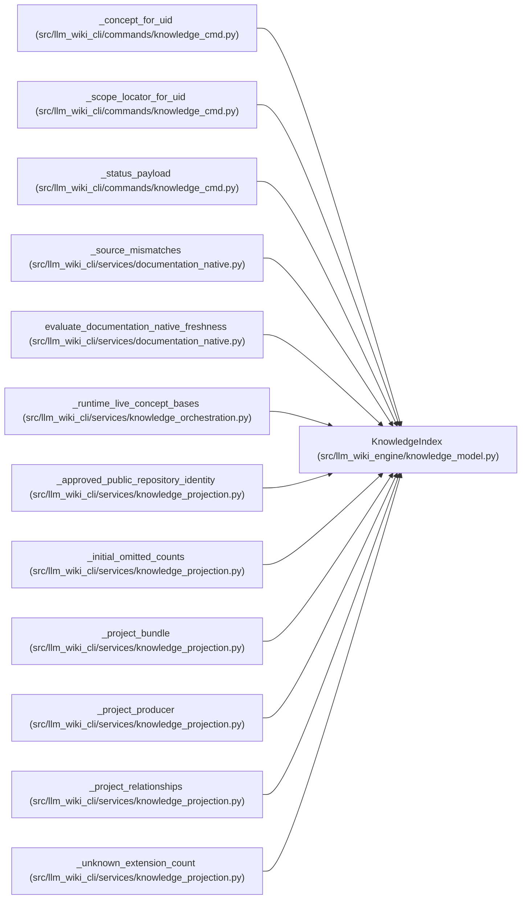

# KnowledgeIndex

**Location:** `src/llm_wiki_engine/knowledge_model.py:477`
**Kind:** Class
**Bases:** —
**Module:** [knowledge_model](../modules/knowledge_model.md)

**Decorators:** `@dataclass(frozen=True)`

## Description

_Auto-generated from `KnowledgeIndex` in `src/llm_wiki_engine/knowledge_model.py`._

## Attributes

| Name | Type | Default | Description |
|------|------|---------|-------------|
| `schema_version` | `str` | *required* | — |
| `bundle` | `BundleRecord` | *required* | — |
| `concepts` | `tuple[ConceptRecord, ...]` | *required* | — |
| `relationships` | `tuple[RelationshipRecord, ...]` | *required* | — |
| `extensions` | `Extensions` | `field(default_factory=dict)` | — |

## Methods

| Method | Signature | Decorators | Description |
|--------|-----------|------------|-------------|
| `from_payload` | `(payload: object) -> 'KnowledgeIndex'` | `@classmethod` | — |
| `to_payload` | `() -> dict[str, Any]` | — | — |
| `to_json` | `() -> str` | — | — |

## Relationships

<!-- Auto-generated relationship summary. Do not edit by hand. -->

### Summary

| Module | Methods | Attributes |
|---|---:|---|
| [knowledge_model](../modules/knowledge_model.md) | 3 | `bundle`, `concepts`, `extensions`, `relationships`, `schema_version` |

### References

| Reference | Kind | Source | Call sites |
|---|---|---|---:|
| `_concept_for_uid` | type_reference | [knowledge_cmd](../modules/knowledge_cmd.md) | — |
| `_scope_locator_for_uid` | type_reference | [knowledge_cmd](../modules/knowledge_cmd.md) | — |
| `_status_payload` | type_reference | [knowledge_cmd](../modules/knowledge_cmd.md) | — |
| `_source_mismatches` | type_reference | [documentation_native](../modules/documentation_native.md) | — |
| `evaluate_documentation_native_freshness` | type_reference | [documentation_native](../modules/documentation_native.md) | — |
| `_runtime_live_concept_bases` | type_reference | [knowledge_orchestration](../modules/knowledge_orchestration.md) | — |
| `_approved_public_repository_identity` | type_reference | [knowledge_projection](../modules/knowledge_projection.md) | — |
| `_initial_omitted_counts` | type_reference | [knowledge_projection](../modules/knowledge_projection.md) | — |
| `_project_bundle` | type_reference | [knowledge_projection](../modules/knowledge_projection.md) | — |
| `_project_producer` | type_reference | [knowledge_projection](../modules/knowledge_projection.md) | — |
| `_project_relationships` | type_reference | [knowledge_projection](../modules/knowledge_projection.md) | — |
| `_unknown_extension_count` | type_reference | [knowledge_projection](../modules/knowledge_projection.md) | — |

> References: showing 12 of 64 logical references; 52 omitted by the 12-row generated summary limit.
