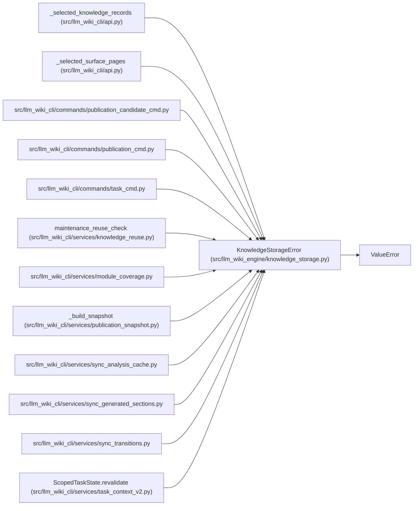

# KnowledgeStorageError

**Location:** `src/llm_wiki_engine/knowledge_storage.py:49`
**Kind:** Class
**Bases:** `ValueError`
**Module:** [knowledge_storage](../modules/knowledge_storage.md)

## Description

A field-specific storage failure with a stable code for malformed data, incompatible formats, mutation or bounded-work exhaustion. Callers preserve these distinctions when reporting unavailable or invalid native input.

## Attributes

*No annotated attributes found.*

## Methods

| Method | Signature | Decorators | Description |
|--------|-----------|------------|-------------|
| `__init__` | `(field: str, message: str, *, code: str = 'storage-invalid')` | — | — |

## Relationships

<!-- Auto-generated relationship summary. Do not edit by hand. -->

### Summary

| Module | Methods | Attributes |
|---|---:|---|
| [knowledge_storage](../modules/knowledge_storage.md) | 1 | — |

### Structure

| Kind | Entity | Module |
|---|---|---|
| Base | `ValueError` | — |

### References

| Reference | Kind | Source | Call sites |
|---|---|---|---:|
| `_selected_knowledge_records` | call | [api](../modules/api.md) | 1 |
| `_selected_surface_pages` | call | [api](../modules/api.md) | 1 |
| `publication_candidate_cmd` | import | [publication_candidate_cmd](../modules/publication_candidate_cmd.md) | — |
| `publication_cmd` | import | [publication_cmd](../modules/publication_cmd.md) | — |
| `task_cmd` | import | [task_cmd](../modules/task_cmd.md) | — |
| `maintenance_reuse_check` | call | [knowledge_reuse](../modules/knowledge_reuse.md) | 2 |
| `module_coverage` | import | [module_coverage](../modules/module_coverage.md) | — |
| `_build_snapshot` | call | [publication_snapshot](../modules/publication_snapshot.md) | 5 |
| `sync_analysis_cache` | import | [sync_analysis_cache](../modules/sync_analysis_cache.md) | — |
| `sync_generated_sections` | import | [sync_generated_sections](../modules/sync_generated_sections.md) | — |
| `sync_transitions` | import | [sync_transitions](../modules/sync_transitions.md) | — |
| `ScopedTaskState.revalidate` | call | [task_context_v2](../modules/task_context_v2.md) | 3 |

> References: showing 12 of 102 logical references; 90 omitted by the 12-row generated summary limit.
