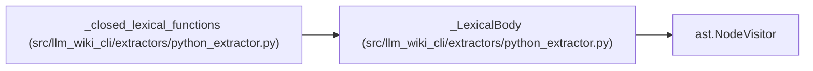

# _LexicalBody

**Location:** `src/llm_wiki_cli/extractors/python_extractor.py:1515`
**Kind:** Class
**Bases:** `ast.NodeVisitor`
**Module:** [python_extractor](../modules/python_extractor.md)

## Description

Current-body writes/calls, without entering deferred definitions.

## Attributes

*No annotated attributes found.*

## Methods

| Method | Signature | Decorators | Description |
|--------|-----------|------------|-------------|
| `__init__` | `()` | — | — |
| `visit_Name` | `(node)` | — | — |
| `visit_Call` | `(node)` | — | — |
| `visit_FunctionDef` | `(node: ast.FunctionDef \| ast.AsyncFunctionDef)` | — | — |
| `visit_AsyncFunctionDef` | `(node)` | — | — |
| `visit_ClassDef` | `(node)` | — | — |
| `visit_Lambda` | `(node)` | — | — |
| `visit_Import` | `(node)` | — | — |
| `visit_ImportFrom` | `(node)` | — | — |
| `visit_ExceptHandler` | `(node)` | — | — |
| `visit_MatchAs` | `(node)` | — | — |
| `visit_MatchStar` | `(node)` | — | — |
| `visit_MatchMapping` | `(node)` | — | — |

## Relationships

<!-- Auto-generated relationship summary. Do not edit by hand. -->

### Summary

| Module | Methods | Attributes |
|---|---:|---|
| [python_extractor](../modules/python_extractor.md) | 13 | — |

### Structure

| Kind | Entity | Module |
|---|---|---|
| Base | `ast.NodeVisitor` | — |

### References

| Reference | Kind | Source | Call sites |
|---|---|---|---:|
| `_closed_lexical_functions` | call | [python_extractor](../modules/python_extractor.md) | 1 |
