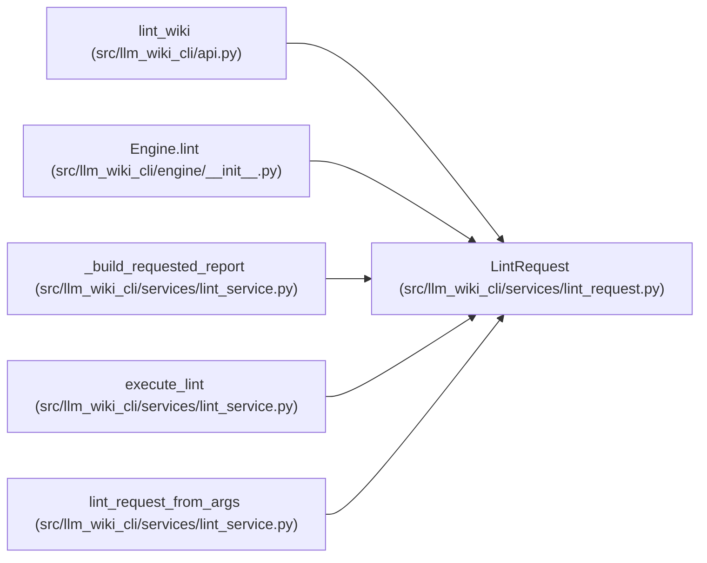

# LintRequest

**Location:** `src/llm_wiki_cli/services/lint_request.py:18`
**Kind:** Class
**Bases:** —
**Module:** [lint_request](../modules/lint_request.md)

**Decorators:** `@dataclass(frozen=True)`

## Description

One lint of ``wiki_root`` against ``source_root``.

Field names describe the behaviour, not CLI flags: ``cache=False`` is
``--no-cache`` and ``allow_external_source`` is ``--allow-external-src``.
``media_size_warn_bytes=None`` keeps the default media size threshold.
``plugins=False`` skips project plugins, as ``doctor`` does.

## Attributes

| Name | Type | Default | Description |
|------|------|---------|-------------|
| `wiki_root` | `str \| Path` | `DEFAULT_WIKI_DIR` | — |
| `source_root` | `str \| Path` | `'.'` | — |
| `strict` | `bool` | `False` | — |
| `plugins` | `bool` | `True` | — |
| `knowledge_drift_report` | `bool` | `False` | — |
| `allow_external_source` | `bool` | `False` | — |
| `source_selection` | `str \| Path \| None` | `None` | — |
| `include_tests` | `Iterable[str] \| None` | `None` | — |
| `helper_cache_dir` | `str \| Path \| None` | `None` | — |
| `media_size_warn_bytes` | `int \| None` | `None` | — |
| `jobs` | `int` | `1` | — |
| `requested_jobs` | `int \| Literal['auto'] \| None` | `None` | — |
| `cache` | `bool` | `True` | — |
| `rebuild_cache` | `bool` | `False` | — |
| `cache_dir` | `str \| Path \| None` | `None` | — |
| `cache_stats` | `bool` | `False` | — |

## Methods

*No declared methods.*

## Relationships

<!-- Auto-generated relationship summary. Do not edit by hand. -->

### Summary

| Module | Methods | Attributes |
|---|---:|---|
| [lint_request](../modules/lint_request.md) | 0 | `allow_external_source`, `cache`, `cache_dir`, `cache_stats`, `helper_cache_dir`, `include_tests`, `jobs`, `knowledge_drift_report`, `media_size_warn_bytes`, `plugins`, `rebuild_cache`, `requested_jobs` |

### References

| Reference | Kind | Source | Call sites |
|---|---|---|---:|
| `lint_wiki` | call | [api](../modules/api.md) | 1 |
| `Engine.lint` | type_reference | [engine___init__](../modules/engine___init__.md) | — |
| `_build_requested_report` | type_reference | [lint_service](../modules/lint_service.md) | — |
| `execute_lint` | type_reference | [lint_service](../modules/lint_service.md) | — |
| `lint_request_from_args` | call | [lint_service](../modules/lint_service.md) | 1 |
| `lint_request_from_args` | type_reference | [lint_service](../modules/lint_service.md) | — |
