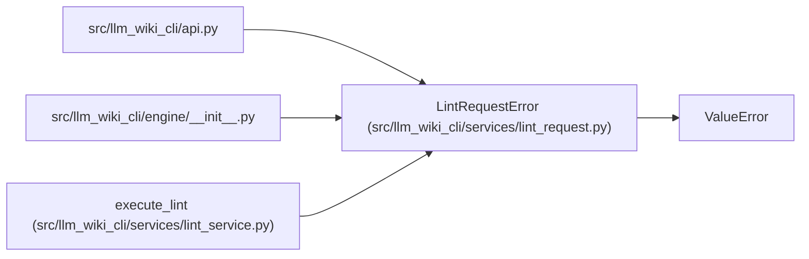

# LintRequestError

**Location:** `src/llm_wiki_cli/services/lint_request.py:45`
**Kind:** Class
**Bases:** `ValueError`
**Module:** [lint_request](../modules/lint_request.md)

## Description

The lint request names a path the workspace policy rejects.

## Attributes

*No annotated attributes found.*

## Methods

*No declared methods.*

## Relationships

<!-- Auto-generated relationship summary. Do not edit by hand. -->

### Summary

| Module | Methods | Attributes |
|---|---:|---|
| [lint_request](../modules/lint_request.md) | 0 | — |

### Structure

| Kind | Entity | Module |
|---|---|---|
| Base | `ValueError` | — |

### References

| Reference | Kind | Source | Call sites |
|---|---|---|---:|
| `api` | import | [api](../modules/api.md) | — |
| `__init__` | import | [engine___init__](../modules/engine___init__.md) | — |
| `execute_lint` | call | [lint_service](../modules/lint_service.md) | 1 |
