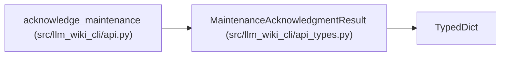

# MaintenanceAcknowledgmentResult

**Location:** `src/llm_wiki_cli/api_types.py:153`
**Kind:** Class
**Bases:** `TypedDict`
**Module:** [api_types](../modules/api_types.md)

## Description

_Auto-generated from `MaintenanceAcknowledgmentResult` in `src/llm_wiki_cli/api_types.py`._

## Attributes

| Name | Type | Presence | Description |
|------|------|----------|-------------|
| `adoption_id` | `str` | *required* | — |
| `record_id` | `str` | *required* | — |
| `changed` | `bool` | *required* | — |
| `state_hash` | `str` | *required* | — |
| `acknowledgment_id` | `str` | *required* | — |
| `actor` | `dict[str, Any]` | *required* | — |
| `governance_effect` | `Literal['none']` | *required* | — |

## Methods

*No public methods. Inherits from base classes.*

## Relationships

<!-- Auto-generated relationship summary. Do not edit by hand. -->

### Summary

| Module | Methods | Attributes |
|---|---:|---|
| [api_types](../modules/api_types.md) | 0 | `acknowledgment_id`, `actor`, `adoption_id`, `changed`, `governance_effect`, `record_id`, `state_hash` |

### Structure

| Kind | Entity | Module |
|---|---|---|
| Base | `TypedDict` | — |

### References

| Reference | Kind | Source | Call sites |
|---|---|---|---:|
| `acknowledge_maintenance` | type_reference | [api](../modules/api.md) | — |
