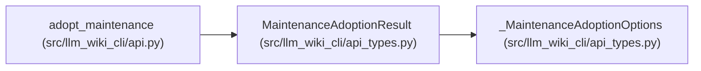

# MaintenanceAdoptionResult

**Location:** `src/llm_wiki_cli/api_types.py:149`
**Kind:** Class
**Bases:** `_MaintenanceAdoptionOptions`
**Module:** [api_types](../modules/api_types.md)

## Description

_Auto-generated from `MaintenanceAdoptionResult` in `src/llm_wiki_cli/api_types.py`._

## Attributes

| Name | Type | Presence | Description |
|------|------|----------|-------------|
| `adoption_id` | `str` | *required* | — |
| `changed` | `bool` | *required* | — |

## Methods

*No declared methods.*

## Relationships

<!-- Auto-generated relationship summary. Do not edit by hand. -->

### Summary

| Module | Methods | Attributes |
|---|---:|---|
| [api_types](../modules/api_types.md) | 0 | `adoption_id`, `changed` |

### Structure

| Kind | Entity | Module |
|---|---|---|
| Base | `_MaintenanceAdoptionOptions` | [api_types](../modules/api_types.md) |

### References

| Reference | Kind | Source | Call sites |
|---|---|---|---:|
| `adopt_maintenance` | type_reference | [api](../modules/api.md) | — |
