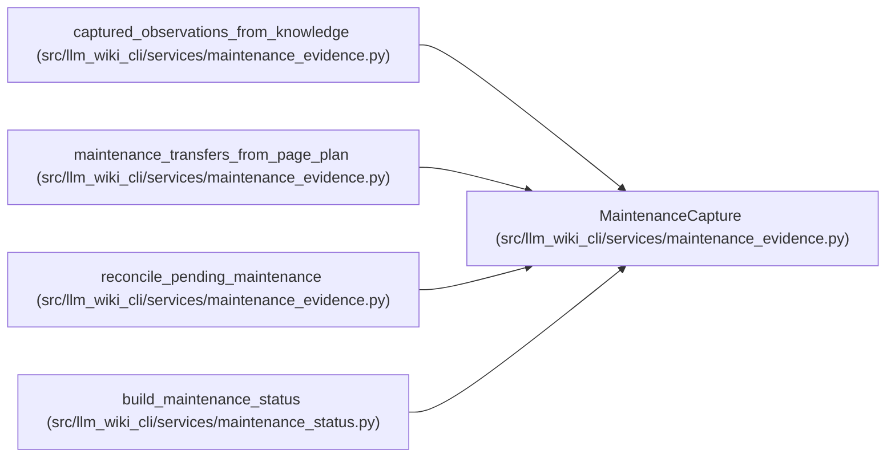

# MaintenanceCapture

**Location:** `src/llm_wiki_cli/services/maintenance_evidence.py:99`
**Kind:** Class
**Bases:** —
**Module:** [maintenance_evidence](../modules/maintenance_evidence.md)

**Decorators:** `@dataclass(frozen=True)`

## Description

_Auto-generated from `MaintenanceCapture` in `src/llm_wiki_cli/services/maintenance_evidence.py`._

## Attributes

| Name | Type | Default | Description |
|------|------|---------|-------------|
| `by_owner` | `Mapping[str, dict[str, Any]]` | *required* | — |
| `missing_source_paths` | `frozenset[str]` | `frozenset()` | — |
| `known_absent_pages` | `frozenset[str]` | `frozenset()` | — |
| `captured_paths` | `frozenset[str]` | `frozenset()` | — |
| `complete_pages` | `frozenset[str]` | `frozenset()` | — |
| `issues` | `tuple[dict[str, Any], ...]` | `()` | — |
| `source_backed_semantic_total` | `int` | `0` | — |
| `tracked_semantic_total` | `int` | `0` | — |

## Methods

| Method | Signature | Decorators | Description |
|--------|-----------|------------|-------------|
| `__post_init__` | `()` | — | — |
| `to_payload` | `() -> dict` | — | — |

## Relationships

<!-- Auto-generated relationship summary. Do not edit by hand. -->

### Summary

| Module | Methods | Attributes |
|---|---:|---|
| [maintenance_evidence](../modules/maintenance_evidence.md) | 2 | `by_owner`, `captured_paths`, `complete_pages`, `issues`, `known_absent_pages`, `missing_source_paths`, `source_backed_semantic_total`, `tracked_semantic_total` |

### References

| Reference | Kind | Source | Call sites |
|---|---|---|---:|
| `captured_observations_from_knowledge` | call | [maintenance_evidence](../modules/maintenance_evidence.md) | 1 |
| `captured_observations_from_knowledge` | type_reference | [maintenance_evidence](../modules/maintenance_evidence.md) | — |
| `maintenance_transfers_from_page_plan` | type_reference | [maintenance_evidence](../modules/maintenance_evidence.md) | — |
| `reconcile_pending_maintenance` | type_reference | [maintenance_evidence](../modules/maintenance_evidence.md) | — |
| `build_maintenance_status` | type_reference | [maintenance_status](../modules/maintenance_status.md) | — |
