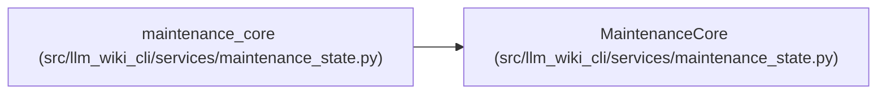

# MaintenanceCore

**Location:** `src/llm_wiki_cli/services/maintenance_state.py:111`
**Kind:** Class
**Bases:** —
**Module:** [maintenance_state](../modules/maintenance_state.md)

## Description

Pure transitions with the installed implementation contract as authority.

## Attributes

*No annotated attributes found.*

## Methods

| Method | Signature | Decorators | Description |
|--------|-----------|------------|-------------|
| `__init__` | `(evidence_validator: Callable[[dict[str, Any]], object])` | — | — |
| `validate_schema` | `(name: str, value: Any) -> None` | — | — |
| `validate_evidence` | `(value: dict[str, Any]) -> None` | — | — |
| `_coordinate` | `(value: dict[str, Any]) -> None` | — | — |
| `_target` | `(target: dict[str, Any]) -> None` | — | — |
| `basis_for` | `(evidence: dict[str, Any], prose_hash: str \| None, target: dict[str, Any] \| None) -> dict[str, Any]` | — | — |
| `observation` | `(evidence: dict[str, Any], prose_hash: str \| None, *, presence = 'present', target: dict[str, Any] \| None, target_presence = 'present') -> dict[str, Any]` | — | — |
| `_validate_observation` | `(value: dict[str, Any]) -> None` | — | — |
| `validate_state` | `(state: dict[str, Any]) -> None` | — | — |
| `initial_state` | `(guard: dict[str, Any], observations: dict[str, dict[str, Any]]) -> dict[str, Any]` | — | Explicit adoption bootstrap records pending/unreviewed, never historical approval. |
| `_ack` | `(record_id: str, actor: dict[str, Any], basis: dict[str, Any]) -> dict[str, Any]` | — | — |
| `transition` | `(state: dict[str, Any], event: dict[str, Any], current_basis: dict[str, Any]) -> dict[str, Any]` | — | Pure maintenance transition. The caller supplies independently captured current basis. |

## Relationships

<!-- Auto-generated relationship summary. Do not edit by hand. -->

### Summary

| Module | Methods | Attributes |
|---|---:|---|
| [maintenance_state](../modules/maintenance_state.md) | 12 | — |

### References

| Reference | Kind | Source | Call sites |
|---|---|---|---:|
| `maintenance_core` | call | [maintenance_state](../modules/maintenance_state.md) | 1 |
| `maintenance_core` | type_reference | [maintenance_state](../modules/maintenance_state.md) | — |
