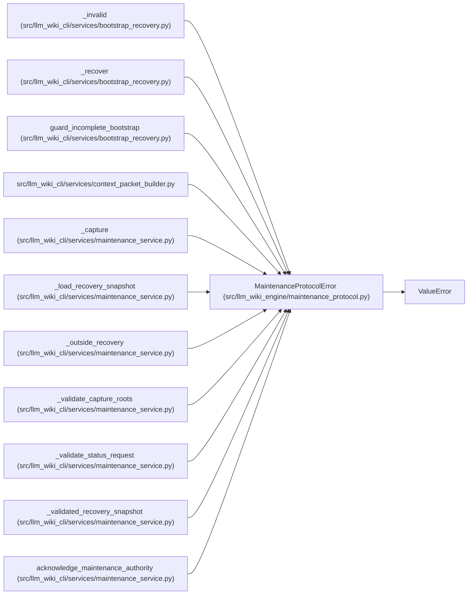

# MaintenanceProtocolError

**Location:** `src/llm_wiki_engine/maintenance_protocol.py:38`
**Kind:** Class
**Bases:** `ValueError`
**Module:** [maintenance_protocol](../modules/maintenance_protocol.md)

## Description

_Auto-generated from `MaintenanceProtocolError` in `src/llm_wiki_engine/maintenance_protocol.py`._

## Attributes

*No annotated attributes found.*

## Methods

| Method | Signature | Decorators | Description |
|--------|-----------|------------|-------------|
| `__init__` | `(reason: str, message: str)` | — | — |

## Relationships

<!-- Auto-generated relationship summary. Do not edit by hand. -->

### Summary

| Module | Methods | Attributes |
|---|---:|---|
| [maintenance_protocol](../modules/maintenance_protocol.md) | 1 | — |

### Structure

| Kind | Entity | Module |
|---|---|---|
| Base | `ValueError` | — |

### References

| Reference | Kind | Source | Call sites |
|---|---|---|---:|
| `_invalid` | call | [bootstrap_recovery](../modules/bootstrap_recovery.md) | 1 |
| `_invalid` | type_reference | [bootstrap_recovery](../modules/bootstrap_recovery.md) | — |
| `_recover` | call | [bootstrap_recovery](../modules/bootstrap_recovery.md) | 3 |
| `guard_incomplete_bootstrap` | call | [bootstrap_recovery](../modules/bootstrap_recovery.md) | 1 |
| `context_packet_builder` | import | [context_packet_builder](../modules/context_packet_builder.md) | — |
| `_capture` | call | [maintenance_service](../modules/maintenance_service.md) | 1 |
| `_load_recovery_snapshot` | call | [maintenance_service](../modules/maintenance_service.md) | 12 |
| `_outside_recovery` | call | [maintenance_service](../modules/maintenance_service.md) | 2 |
| `_validate_capture_roots` | call | [maintenance_service](../modules/maintenance_service.md) | 2 |
| `_validate_status_request` | call | [maintenance_service](../modules/maintenance_service.md) | 1 |
| `_validated_recovery_snapshot` | call | [maintenance_service](../modules/maintenance_service.md) | 1 |
| `acknowledge_maintenance_authority` | call | [maintenance_service](../modules/maintenance_service.md) | 7 |

> References: showing 12 of 34 logical references; 22 omitted by the 12-row generated summary limit.
