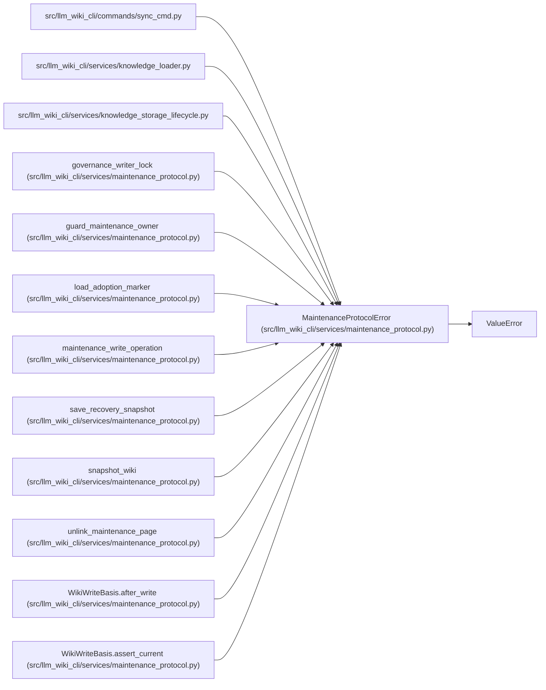

# MaintenanceProtocolError

**Location:** `src/llm_wiki_cli/services/maintenance_protocol.py:30`
**Kind:** Class
**Bases:** `ValueError`
**Module:** [maintenance_protocol](../modules/maintenance_protocol.md)

## Description

_Auto-generated from `MaintenanceProtocolError` in `src/llm_wiki_cli/services/maintenance_protocol.py`._

## Attributes

*No annotated attributes found.*

## Methods

| Method | Signature | Decorators | Description |
|--------|-----------|------------|-------------|
| `__init__` | `(reason: str, message: str)` | — | — |

## Relationships

<!-- Auto-generated relationship summary. Do not edit by hand. -->

### Summary

| Module | Methods | Attributes |
|---|---:|---|
| [maintenance_protocol](../modules/maintenance_protocol.md) | 1 | — |

### Structure

| Kind | Entity | Module |
|---|---|---|
| Base | `ValueError` | — |

### References

| Reference | Kind | Source | Call sites |
|---|---|---|---:|
| `sync_cmd` | import | [sync_cmd](../modules/sync_cmd.md) | — |
| `knowledge_loader` | import | [knowledge_loader](../modules/knowledge_loader.md) | — |
| `knowledge_storage_lifecycle` | import | [knowledge_storage_lifecycle](../modules/knowledge_storage_lifecycle.md) | — |
| `governance_writer_lock` | call | [maintenance_protocol](../modules/maintenance_protocol.md) | 1 |
| `guard_maintenance_owner` | call | [maintenance_protocol](../modules/maintenance_protocol.md) | 7 |
| `load_adoption_marker` | call | [maintenance_protocol](../modules/maintenance_protocol.md) | 1 |
| `maintenance_write_operation` | call | [maintenance_protocol](../modules/maintenance_protocol.md) | 1 |
| `save_recovery_snapshot` | call | [maintenance_protocol](../modules/maintenance_protocol.md) | 1 |
| `snapshot_wiki` | call | [maintenance_protocol](../modules/maintenance_protocol.md) | 1 |
| `unlink_maintenance_page` | call | [maintenance_protocol](../modules/maintenance_protocol.md) | 1 |
| `WikiWriteBasis.after_write` | call | [maintenance_protocol](../modules/maintenance_protocol.md) | 2 |
| `WikiWriteBasis.assert_current` | call | [maintenance_protocol](../modules/maintenance_protocol.md) | 1 |

> References: showing 12 of 23 logical references; 11 omitted by the 12-row generated summary limit.
