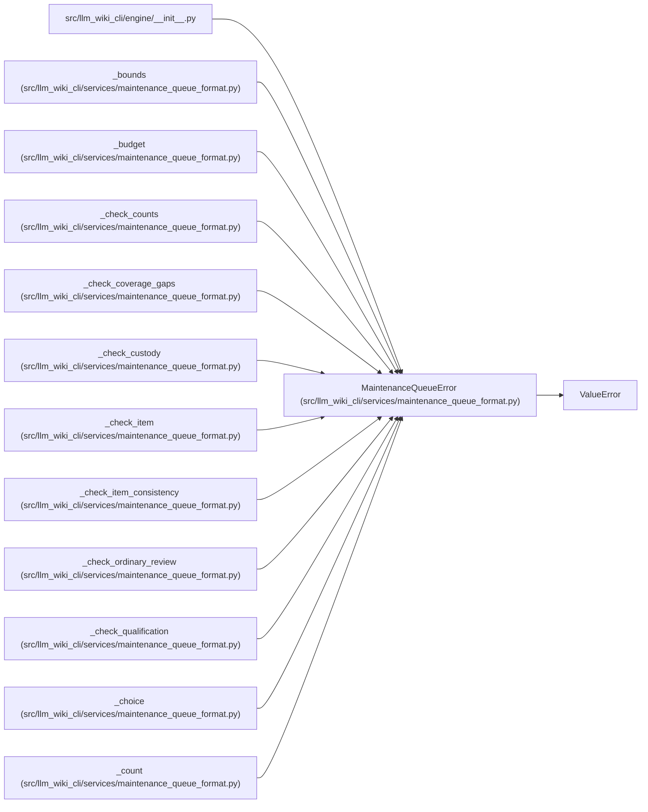

# MaintenanceQueueError

**Location:** `src/llm_wiki_cli/services/maintenance_queue_format.py:122`
**Kind:** Class
**Bases:** `ValueError`
**Module:** [maintenance_queue_format](../modules/maintenance_queue_format.md)

## Description

A maintenance queue report does not satisfy its published format.

## Attributes

*No annotated attributes found.*

## Methods

*No declared methods.*

## Relationships

<!-- Auto-generated relationship summary. Do not edit by hand. -->

### Summary

| Module | Methods | Attributes |
|---|---:|---|
| [maintenance_queue_format](../modules/maintenance_queue_format.md) | 0 | — |

### Structure

| Kind | Entity | Module |
|---|---|---|
| Base | `ValueError` | — |

### References

| Reference | Kind | Source | Call sites |
|---|---|---|---:|
| `__init__` | import | [engine___init__](../modules/engine___init__.md) | — |
| `_bounds` | call | [maintenance_queue_format](../modules/maintenance_queue_format.md) | 3 |
| `_budget` | call | [maintenance_queue_format](../modules/maintenance_queue_format.md) | 1 |
| `_check_counts` | call | [maintenance_queue_format](../modules/maintenance_queue_format.md) | 5 |
| `_check_coverage_gaps` | call | [maintenance_queue_format](../modules/maintenance_queue_format.md) | 2 |
| `_check_custody` | call | [maintenance_queue_format](../modules/maintenance_queue_format.md) | 3 |
| `_check_item` | call | [maintenance_queue_format](../modules/maintenance_queue_format.md) | 2 |
| `_check_item_consistency` | call | [maintenance_queue_format](../modules/maintenance_queue_format.md) | 7 |
| `_check_ordinary_review` | call | [maintenance_queue_format](../modules/maintenance_queue_format.md) | 5 |
| `_check_qualification` | call | [maintenance_queue_format](../modules/maintenance_queue_format.md) | 2 |
| `_choice` | call | [maintenance_queue_format](../modules/maintenance_queue_format.md) | 1 |
| `_count` | call | [maintenance_queue_format](../modules/maintenance_queue_format.md) | 1 |

> References: showing 12 of 21 logical references; 9 omitted by the 12-row generated summary limit.
