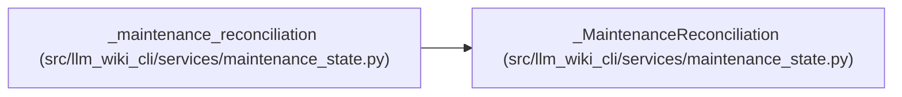

# _MaintenanceReconciliation

**Location:** `src/llm_wiki_cli/services/maintenance_state.py:1029`
**Kind:** Class
**Bases:** —
**Module:** [maintenance_state](../modules/maintenance_state.md)

## Description

One detached reconciliation; only membership-preserving observes are local.

## Attributes

*No annotated attributes found.*

## Methods

| Method | Signature | Decorators | Description |
|--------|-----------|------------|-------------|
| `__init__` | `(previous_state, core)` | — | — |
| `_refresh_groups` | `()` | — | — |
| `__enter__` | `()` | — | — |
| `__exit__` | `(*args)` | — | — |
| `_expire` | `()` | — | — |
| `_check` | `()` | — | — |
| `_event_owned` | `(state, record_id, kind, **fields)` | — | — |
| `apply` | `(event, current_basis) -> None` | — | — |
| `_apply_owned` | `(state, event, current_basis)` | — | — |
| `finish` | `() -> dict[str, Any]` | — | — |

## Relationships

<!-- Auto-generated relationship summary. Do not edit by hand. -->

### Summary

| Module | Methods | Attributes |
|---|---:|---|
| [maintenance_state](../modules/maintenance_state.md) | 10 | — |

### References

| Reference | Kind | Source | Call sites |
|---|---|---|---:|
| `_maintenance_reconciliation` | call | [maintenance_state](../modules/maintenance_state.md) | 1 |
