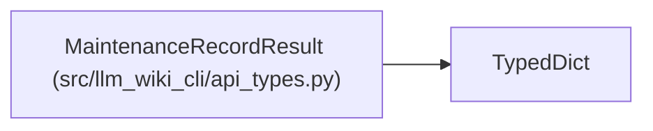

# MaintenanceRecordResult

**Location:** `src/llm_wiki_cli/api_types.py:102`
**Kind:** Class
**Bases:** `TypedDict`
**Module:** [api_types](../modules/api_types.md)

## Description

_Auto-generated from `MaintenanceRecordResult` in `src/llm_wiki_cli/api_types.py`._

## Attributes

| Name | Type | Presence | Description |
|------|------|----------|-------------|
| `record_id` | `str` | *required* | — |
| `coordinate` | `dict[str, Any]` | *required* | — |
| `target` | `dict[str, Any]` | *required* | — |
| `mapping` | `dict[str, Any]` | *required* | — |
| `recorded_status` | `Literal['pending', 'acknowledged']` | *required* | — |
| `effective_status` | `Literal['pending', 'acknowledged'] \| None` | *required* | — |
| `reasons` | `list[str]` | *required* | — |
| `recorded_basis` | `dict[str, Any]` | *required* | — |
| `expected_basis` | `dict[str, Any] \| None` | *required* | — |
| `basis_available` | `bool` | *required* | — |
| `acknowledgment` | `dict[str, Any] \| None` | *required* | — |
| `acknowledgment_history` | `list[dict[str, Any]]` | *required* | — |
| `history_bounds` | `dict[str, int \| bool]` | *required* | — |
| `source_location` | `dict[str, Any] \| None` | *required* | — |
| `qualification` | `Literal['snapshot', 'current-capture', 'current-basis-unavailable']` | *required* | — |
| `governance_effect` | `Literal['none']` | *required* | — |

## Methods

*No public methods. Inherits from base classes.*

## Relationships

<!-- Auto-generated relationship summary. Do not edit by hand. -->

### Summary

| Module | Methods | Attributes |
|---|---:|---|
| [api_types](../modules/api_types.md) | 0 | `acknowledgment`, `acknowledgment_history`, `basis_available`, `coordinate`, `effective_status`, `expected_basis`, `governance_effect`, `history_bounds`, `mapping`, `qualification`, `reasons`, `record_id` |

### Structure

| Kind | Entity | Module |
|---|---|---|
| Base | `TypedDict` | — |
