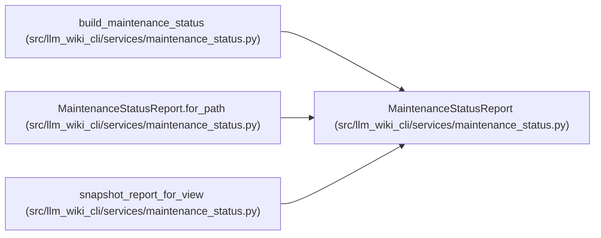

# MaintenanceStatusReport

**Location:** `src/llm_wiki_cli/services/maintenance_status.py:87`
**Kind:** Class
**Bases:** —
**Module:** [maintenance_status](../modules/maintenance_status.md)

**Decorators:** `@dataclass(frozen=True)`

## Description

_Auto-generated from `MaintenanceStatusReport` in `src/llm_wiki_cli/services/maintenance_status.py`._

## Attributes

| Name | Type | Default | Description |
|------|------|---------|-------------|
| `payload` | `Mapping[str, Any]` | *required* | — |
| `by_record` | `Mapping[str, Mapping[str, Any]]` | *required* | — |
| `by_path` | `Mapping[str, tuple[str, ...]]` | *required* | — |

## Methods

| Method | Signature | Decorators | Description |
|--------|-----------|------------|-------------|
| `__post_init__` | `()` | — | — |
| `to_payload` | `(*, record_id = None, limit = 30) -> dict` | — | — |
| `for_path` | `(path) -> dict` | — | — |

## Relationships

<!-- Auto-generated relationship summary. Do not edit by hand. -->

### Summary

| Module | Methods | Attributes |
|---|---:|---|
| [maintenance_status](../modules/maintenance_status.md) | 3 | `by_path`, `by_record`, `payload` |

### References

| Reference | Kind | Source | Call sites |
|---|---|---|---:|
| `build_maintenance_status` | call | [maintenance_status](../modules/maintenance_status.md) | 2 |
| `build_maintenance_status` | type_reference | [maintenance_status](../modules/maintenance_status.md) | — |
| `MaintenanceStatusReport.for_path` | call | [maintenance_status](../modules/maintenance_status.md) | 1 |
| `snapshot_report_for_view` | type_reference | [maintenance_status](../modules/maintenance_status.md) | — |
