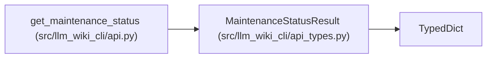

# MaintenanceStatusResult

**Location:** `src/llm_wiki_cli/api_types.py:126`
**Kind:** Class
**Bases:** `TypedDict`
**Module:** [api_types](../modules/api_types.md)

## Description

_Auto-generated from `MaintenanceStatusResult` in `src/llm_wiki_cli/api_types.py`._

## Attributes

| Name | Type | Presence | Description |
|------|------|----------|-------------|
| `schema_version` | `str` | *required* | — |
| `availability` | `str` | *required* | — |
| `adoption_id` | `str \| None` | *required* | — |
| `state_hash` | `str \| None` | *required* | — |
| `analysis_scope` | `str` | *required* | — |
| `live_evaluation_performed` | `bool` | *required* | — |
| `native_prose_coherent` | `bool` | *required* | — |
| `requires_sync` | `bool` | *required* | — |
| `coverage` | `dict[str, Any]` | *required* | — |
| `bounds` | `dict[str, Any]` | *required* | — |
| `records` | `list[MaintenanceRecordResult]` | *required* | — |
| `limitations` | `list[str]` | *required* | — |

## Methods

*No public methods. Inherits from base classes.*

## Relationships

<!-- Auto-generated relationship summary. Do not edit by hand. -->

### Summary

| Module | Methods | Attributes |
|---|---:|---|
| [api_types](../modules/api_types.md) | 0 | `adoption_id`, `analysis_scope`, `availability`, `bounds`, `coverage`, `limitations`, `live_evaluation_performed`, `native_prose_coherent`, `records`, `requires_sync`, `schema_version`, `state_hash` |

### Structure

| Kind | Entity | Module |
|---|---|---|
| Base | `TypedDict` | — |

### References

| Reference | Kind | Source | Call sites |
|---|---|---|---:|
| `get_maintenance_status` | type_reference | [api](../modules/api.md) | — |
