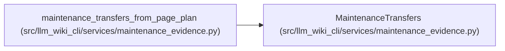

# MaintenanceTransfers

**Location:** `src/llm_wiki_cli/services/maintenance_evidence.py:648`
**Kind:** Class
**Bases:** —
**Module:** [maintenance_evidence](../modules/maintenance_evidence.md)

**Decorators:** `@dataclass(frozen=True)`

## Description

_Auto-generated from `MaintenanceTransfers` in `src/llm_wiki_cli/services/maintenance_evidence.py`._

## Attributes

| Name | Type | Default | Description |
|------|------|---------|-------------|
| `confirmed` | `tuple[dict[str, Any], ...]` | `()` | — |
| `ambiguous` | `tuple[dict[str, Any], ...]` | `()` | — |
| `issues` | `tuple[dict[str, Any], ...]` | `()` | — |

## Methods

| Method | Signature | Decorators | Description |
|--------|-----------|------------|-------------|
| `__post_init__` | `()` | — | — |

## Relationships

<!-- Auto-generated relationship summary. Do not edit by hand. -->

### Summary

| Module | Methods | Attributes |
|---|---:|---|
| [maintenance_evidence](../modules/maintenance_evidence.md) | 1 | `ambiguous`, `confirmed`, `issues` |

### References

| Reference | Kind | Source | Call sites |
|---|---|---|---:|
| `maintenance_transfers_from_page_plan` | call | [maintenance_evidence](../modules/maintenance_evidence.md) | 2 |
| `maintenance_transfers_from_page_plan` | type_reference | [maintenance_evidence](../modules/maintenance_evidence.md) | — |
