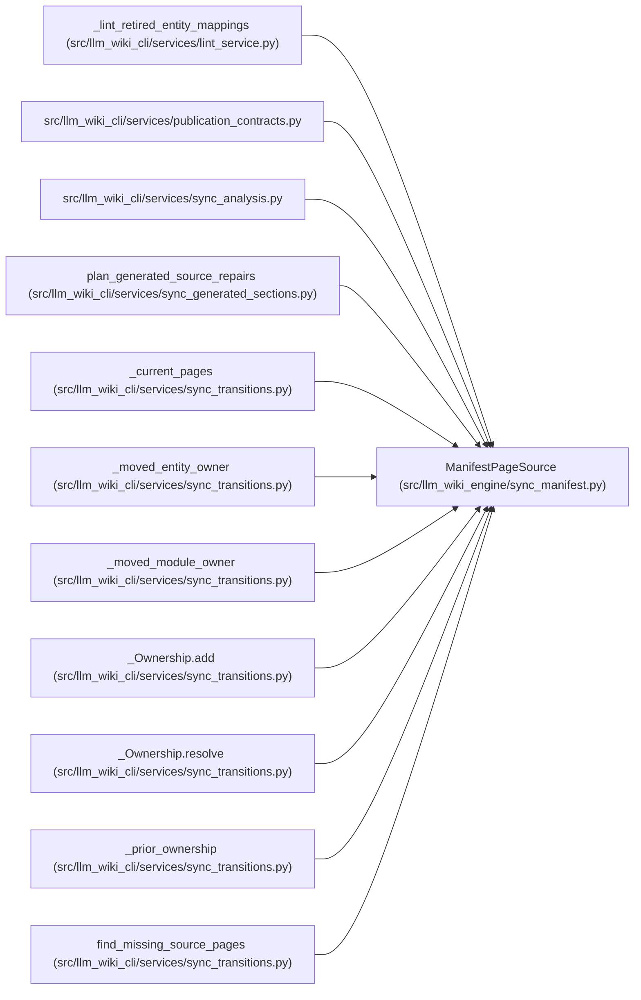

# ManifestPageSource

**Location:** `src/llm_wiki_engine/sync_manifest.py:152`
**Kind:** Class
**Bases:** —
**Module:** [sync_manifest](../modules/sync_manifest.md)

**Decorators:** `@dataclass(frozen=True)`

## Description

Last observed source coordinate for one module or entity page.

## Attributes

| Name | Type | Default | Description |
|------|------|---------|-------------|
| `scope` | `str` | *required* | — |
| `source_path` | `str` | *required* | — |
| `entity_name` | `str \| None` | `None` | — |
| `occurrence` | `int \| None` | `None` | — |

## Methods

| Method | Signature | Decorators | Description |
|--------|-----------|------------|-------------|
| `__post_init__` | `() -> None` | — | — |
| `to_payload` | `() -> dict[str, object]` | — | — |
| `from_payload` | `(value: object, field_name: str) -> ManifestPageSource` | `@classmethod` | — |

## Relationships

<!-- Auto-generated relationship summary. Do not edit by hand. -->

### Summary

| Module | Methods | Attributes |
|---|---:|---|
| [sync_manifest](../modules/sync_manifest.md) | 3 | `entity_name`, `occurrence`, `scope`, `source_path` |

### References

| Reference | Kind | Source | Call sites |
|---|---|---|---:|
| `_lint_retired_entity_mappings` | type_reference | [lint_service](../modules/lint_service.md) | — |
| `publication_contracts` | import | [publication_contracts](../modules/publication_contracts.md) | — |
| `sync_analysis` | import | [sync_analysis](../modules/sync_analysis.md) | — |
| `plan_generated_source_repairs` | type_reference | [sync_generated_sections](../modules/sync_generated_sections.md) | — |
| `_current_pages` | call | [sync_transitions](../modules/sync_transitions.md) | 2 |
| `_current_pages` | type_reference | [sync_transitions](../modules/sync_transitions.md) | — |
| `_moved_entity_owner` | type_reference | [sync_transitions](../modules/sync_transitions.md) | — |
| `_moved_module_owner` | type_reference | [sync_transitions](../modules/sync_transitions.md) | — |
| `_Ownership.add` | type_reference | [sync_transitions](../modules/sync_transitions.md) | — |
| `_Ownership.resolve` | type_reference | [sync_transitions](../modules/sync_transitions.md) | — |
| `_prior_ownership` | call | [sync_transitions](../modules/sync_transitions.md) | 4 |
| `find_missing_source_pages` | type_reference | [sync_transitions](../modules/sync_transitions.md) | — |

> References: showing 12 of 30 logical references; 18 omitted by the 12-row generated summary limit.
