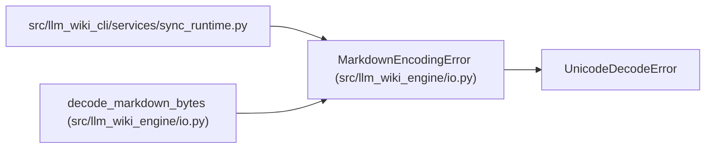

# MarkdownEncodingError

**Location:** `src/llm_wiki_engine/io.py:134`
**Kind:** Class
**Bases:** `UnicodeDecodeError`
**Module:** [io](../modules/io.md)

## Description

A Markdown page whose bytes are neither UTF-8 nor Windows-1252.

It is a :class:`UnicodeDecodeError`, so existing handlers still catch it;
its message names the page and how to repair it.

## Attributes

*No annotated attributes found.*

## Methods

| Method | Signature | Decorators | Description |
|--------|-----------|------------|-------------|
| `__init__` | `(page: str \| None, cause: UnicodeDecodeError) -> None` | — | — |
| `__str__` | `() -> str` | — | — |

## Relationships

<!-- Auto-generated relationship summary. Do not edit by hand. -->

### Summary

| Module | Methods | Attributes |
|---|---:|---|
| [io](../modules/io.md) | 2 | — |

### Structure

| Kind | Entity | Module |
|---|---|---|
| Base | `UnicodeDecodeError` | — |

### References

| Reference | Kind | Source | Call sites |
|---|---|---|---:|
| `sync_runtime` | import | [sync_runtime](../modules/sync_runtime.md) | — |
| `decode_markdown_bytes` | call | [io](../modules/io.md) | 1 |
