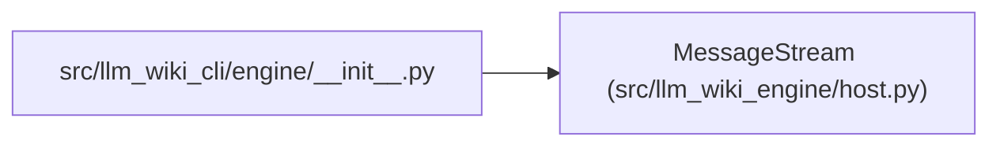

# MessageStream

**Location:** `src/llm_wiki_engine/host.py:203`
**Kind:** Class
**Bases:** —
**Module:** [host](../modules/host.md)

## Description

A stream that writes to the active host and reports each line as an event.

For code that writes to a stream object rather than calling :func:`emit`.
A trailing partial line is reported by :meth:`close`.

## Attributes

*No annotated attributes found.*

## Methods

| Method | Signature | Decorators | Description |
|--------|-----------|------------|-------------|
| `__init__` | `(stream: Stream = 'stdout') -> None` | — | — |
| `_target` | `() -> tuple[Host, TextSink]` | — | — |
| `write` | `(text: str, /) -> int` | — | — |
| `flush` | `() -> None` | — | — |
| `close` | `() -> None` | — | — |

## Relationships

<!-- Auto-generated relationship summary. Do not edit by hand. -->

### Summary

| Module | Methods | Attributes |
|---|---:|---|
| [host](../modules/host.md) | 5 | — |

### References

| Reference | Kind | Source | Call sites |
|---|---|---|---:|
| `__init__` | import | [engine___init__](../modules/engine___init__.md) | — |
