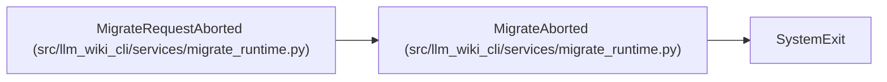

# MigrateAborted

**Location:** `src/llm_wiki_cli/services/migrate_runtime.py:1737`
**Kind:** Class
**Bases:** `SystemExit`
**Module:** [migrate_runtime](../modules/migrate_runtime.md)

## Description

Migration stopped with an exit status; ``message`` is what it reported.

## Attributes

*No annotated attributes found.*

## Methods

| Method | Signature | Decorators | Description |
|--------|-----------|------------|-------------|
| `__init__` | `(code: int, message: str = '') -> None` | — | — |

## Relationships

<!-- Auto-generated relationship summary. Do not edit by hand. -->

### Summary

| Module | Methods | Attributes |
|---|---:|---|
| [migrate_runtime](../modules/migrate_runtime.md) | 1 | — |

### Structure

| Kind | Entity | Module |
|---|---|---|
| Base | `SystemExit` | — |
| Subclass | `MigrateRequestAborted` | [migrate_runtime](../modules/migrate_runtime.md) |
