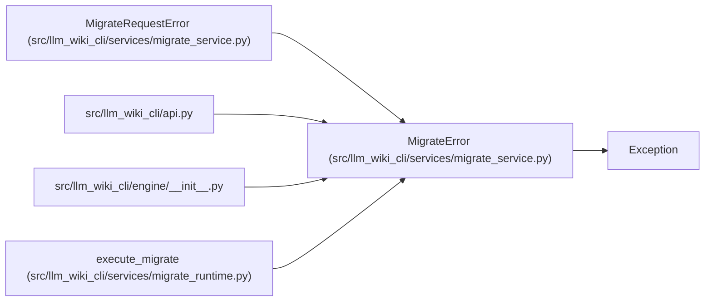

# MigrateError

**Location:** `src/llm_wiki_cli/services/migrate_service.py:71`
**Kind:** Class
**Bases:** `Exception`
**Module:** [migrate_service](../modules/migrate_service.md)

## Description

Migration stopped; ``exit_code`` is the status the CLI would exit with.

## Attributes

*No annotated attributes found.*

## Methods

| Method | Signature | Decorators | Description |
|--------|-----------|------------|-------------|
| `__init__` | `(message: str, *, exit_code: int) -> None` | — | — |

## Relationships

<!-- Auto-generated relationship summary. Do not edit by hand. -->

### Summary

| Module | Methods | Attributes |
|---|---:|---|
| [migrate_service](../modules/migrate_service.md) | 1 | — |

### Structure

| Kind | Entity | Module |
|---|---|---|
| Base | `Exception` | — |
| Subclass | `MigrateRequestError` | [migrate_service](../modules/migrate_service.md) |

### References

| Reference | Kind | Source | Call sites |
|---|---|---|---:|
| `api` | import | [api](../modules/api.md) | — |
| `__init__` | import | [engine___init__](../modules/engine___init__.md) | — |
| `execute_migrate` | call | [migrate_runtime](../modules/migrate_runtime.md) | 1 |
