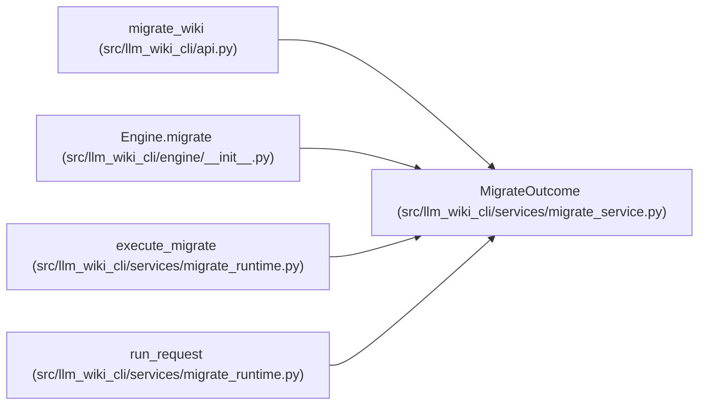

# MigrateOutcome

**Location:** `src/llm_wiki_cli/services/migrate_service.py:40`
**Kind:** Class
**Bases:** —
**Module:** [migrate_service](../modules/migrate_service.md)

**Decorators:** `@dataclass(frozen=True)`

## Description

What one migration did; human-readable progress went to the host streams.

``complete`` is true once the migration's final step has run (or, for a
dry run, would run); a chunked migration reports which chunk it applied.

## Attributes

| Name | Type | Default | Description |
|------|------|---------|-------------|
| `status` | `MigrateStatus` | *required* | — |
| `dry_run` | `bool` | *required* | — |
| `canonical_pages` | `int` | `0` | — |
| `archived_pages` | `int` | `0` | — |
| `unmatched_pages` | `int` | `0` | — |
| `chunk` | `int \| None` | `None` | — |
| `chunk_total` | `int \| None` | `None` | — |
| `page_operations` | `int` | `0` | — |
| `complete` | `bool` | `False` | — |

## Methods

| Method | Signature | Decorators | Description |
|--------|-----------|------------|-------------|
| `to_dict` | `() -> dict[str, Any]` | — | — |

## Relationships

<!-- Auto-generated relationship summary. Do not edit by hand. -->

### Summary

| Module | Methods | Attributes |
|---|---:|---|
| [migrate_service](../modules/migrate_service.md) | 1 | `archived_pages`, `canonical_pages`, `chunk`, `chunk_total`, `complete`, `dry_run`, `page_operations`, `status`, `unmatched_pages` |

### References

| Reference | Kind | Source | Call sites |
|---|---|---|---:|
| `migrate_wiki` | type_reference | [api](../modules/api.md) | — |
| `Engine.migrate` | type_reference | [engine___init__](../modules/engine___init__.md) | — |
| `execute_migrate` | type_reference | [migrate_runtime](../modules/migrate_runtime.md) | — |
| `run_request` | call | [migrate_runtime](../modules/migrate_runtime.md) | 4 |
| `run_request` | type_reference | [migrate_runtime](../modules/migrate_runtime.md) | — |
