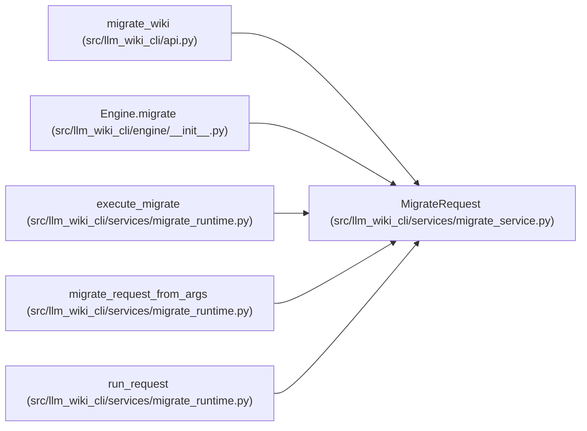

# MigrateRequest

**Location:** `src/llm_wiki_cli/services/migrate_service.py:19`
**Kind:** Class
**Bases:** —
**Module:** [migrate_service](../modules/migrate_service.md)

**Decorators:** `@dataclass(frozen=True)`

## Description

One migration of a wiki written by an older llm-wiki to current naming.

``chunk_size`` splits the work into reviewable chunks; ``chunk`` applies
one of them (default: the first pending chunk) and ``plan_chunks`` only
reports the chunk plan. ``plugins=False`` scans the source without
project plugins.

## Attributes

| Name | Type | Default | Description |
|------|------|---------|-------------|
| `source_root` | `str \| Path` | `'.'` | — |
| `wiki_root` | `str \| Path` | `DEFAULT_WIKI_DIR` | — |
| `dry_run` | `bool` | `False` | — |
| `chunk_size` | `int \| None` | `None` | — |
| `chunk` | `int \| None` | `None` | — |
| `plan_chunks` | `bool` | `False` | — |
| `plugins` | `bool` | `True` | — |
| `allow_external_source` | `bool` | `False` | — |
| `source_selection` | `str \| Path \| None` | `None` | — |

## Methods

*No declared methods.*

## Relationships

<!-- Auto-generated relationship summary. Do not edit by hand. -->

### Summary

| Module | Methods | Attributes |
|---|---:|---|
| [migrate_service](../modules/migrate_service.md) | 0 | `allow_external_source`, `chunk`, `chunk_size`, `dry_run`, `plan_chunks`, `plugins`, `source_root`, `source_selection`, `wiki_root` |

### References

| Reference | Kind | Source | Call sites |
|---|---|---|---:|
| `migrate_wiki` | call | [api](../modules/api.md) | 1 |
| `Engine.migrate` | type_reference | [engine___init__](../modules/engine___init__.md) | — |
| `execute_migrate` | type_reference | [migrate_runtime](../modules/migrate_runtime.md) | — |
| `migrate_request_from_args` | call | [migrate_runtime](../modules/migrate_runtime.md) | 1 |
| `migrate_request_from_args` | type_reference | [migrate_runtime](../modules/migrate_runtime.md) | — |
| `run_request` | type_reference | [migrate_runtime](../modules/migrate_runtime.md) | — |
