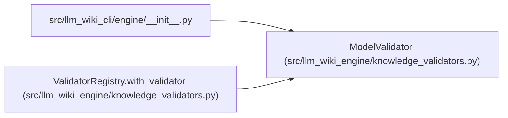

# ModelValidator

**Location:** `src/llm_wiki_engine/knowledge_validators.py:39`
**Kind:** Class
**Bases:** —
**Module:** [knowledge_validators](../modules/knowledge_validators.md)

**Decorators:** `@dataclass(frozen=True)`

## Description

One acceptance check run on every parsed knowledge index.

``check`` receives the parsed model and raises
:class:`~llm_wiki_engine.knowledge_model.KnowledgeModelError` to
reject it; a ``ValueError``, ``TypeError`` or ``KeyError`` is reported as
one too. ``modules`` are importable module names whose functions and
upper-case policy values define the check; changing any of them
invalidates earlier validation.

## Attributes

| Name | Type | Default | Description |
|------|------|---------|-------------|
| `name` | `str` | *required* | — |
| `check` | `Callable[[KnowledgeIndex], object]` | *required* | — |
| `modules` | `tuple[str, ...]` | `()` | — |

## Methods

| Method | Signature | Decorators | Description |
|--------|-----------|------------|-------------|
| `__post_init__` | `() -> None` | — | — |

## Relationships

<!-- Auto-generated relationship summary. Do not edit by hand. -->

### Summary

| Module | Methods | Attributes |
|---|---:|---|
| [knowledge_validators](../modules/knowledge_validators.md) | 1 | `check`, `modules`, `name` |

### References

| Reference | Kind | Source | Call sites |
|---|---|---|---:|
| `__init__` | import | [engine___init__](../modules/engine___init__.md) | — |
| `ValidatorRegistry.with_validator` | type_reference | [knowledge_validators](../modules/knowledge_validators.md) | — |
