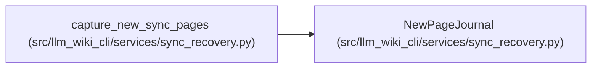

# NewPageJournal

**Location:** `src/llm_wiki_cli/services/sync_recovery.py:138`
**Kind:** Class
**Bases:** —
**Module:** [sync_recovery](../modules/sync_recovery.md)

**Decorators:** `@dataclass`

## Description

Records only operation-created Markdown pages, excluding physical preimages,
committed outgoing owners and selected source paths. Intended bytes are saved
before each write and bound to the completed file identity afterward. Rejected
operations retain their journal and postimages; successful operations discard
only unchanged private scratch. This observer supplies no publication authority.

## Attributes

| Name | Type | Default | Description |
|------|------|---------|-------------|
| `root` | `Path` | *required* | — |
| `snapshot` | `SourceSnapshot` | *required* | — |
| `manifest` | `Any` | `None` | — |
| `before` | `set[str]` | `field(init=False)` | — |
| `record` | `dict[str, Any]` | `field(init=False)` | — |
| `directory` | `Path \| None` | `None` | — |
| `written_bytes` | `int` | `0` | — |

## Methods

| Method | Signature | Decorators | Description |
|--------|-----------|------------|-------------|
| `__post_init__` | `()` | — | — |
| `_persist` | `()` | — | — |
| `before_write` | `(path: Path, content: bytes \| None)` | — | — |
| `after_write` | `(path: Path, content: bytes \| None)` | — | — |
| `discard_committed` | `()` | — | Remove only this successful operation's verified private scratch. |

## Relationships

<!-- Auto-generated relationship summary. Do not edit by hand. -->

### Summary

| Module | Methods | Attributes |
|---|---:|---|
| [sync_recovery](../modules/sync_recovery.md) | 5 | `before`, `directory`, `manifest`, `record`, `root`, `snapshot`, `written_bytes` |

### References

| Reference | Kind | Source | Call sites |
|---|---|---|---:|
| `capture_new_sync_pages` | call | [sync_recovery](../modules/sync_recovery.md) | 1 |
