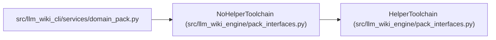

# NoHelperToolchain

**Location:** `src/llm_wiki_engine/pack_interfaces.py:300`
**Kind:** Class
**Bases:** `HelperToolchain`
**Module:** [pack_interfaces](../modules/pack_interfaces.md)

## Description

Needs and prepares no helpers.

A pack using it should classify only sources that in-process extractors
handle; a source kind whose extractor needs a helper still fails without one.

## Attributes

*No annotated attributes found.*

## Methods

| Method | Signature | Decorators | Description |
|--------|-----------|------------|-------------|
| `languages` | `(snapshot: Any, registry: Mapping[str, str], *, only_files: Iterable[str] \| None = None) -> tuple[str, ...]` | — | — |
| `prepare` | `(snapshot: Any, registry: Mapping[str, str], *, only_files: Iterable[str] \| None = None, cache_dir: str \| None = None) -> tuple[Any, ...]` | — | — |

## Relationships

<!-- Auto-generated relationship summary. Do not edit by hand. -->

### Summary

| Module | Methods | Attributes |
|---|---:|---|
| [pack_interfaces](../modules/pack_interfaces.md) | 2 | — |

### Structure

| Kind | Entity | Module |
|---|---|---|
| Base | `HelperToolchain` | [pack_interfaces](../modules/pack_interfaces.md) |

### References

| Reference | Kind | Source | Call sites |
|---|---|---|---:|
| `domain_pack` | import | [domain_pack](../modules/domain_pack.md) | — |
