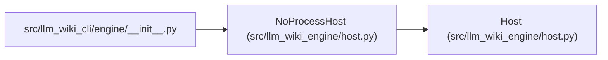

# NoProcessHost

**Location:** `src/llm_wiki_engine/host.py:142`
**Kind:** Class
**Bases:** `Host`
**Module:** [host](../modules/host.md)

## Description

A host that grants no subprocesses; everything else is local.

## Attributes

*No annotated attributes found.*

## Methods

| Method | Signature | Decorators | Description |
|--------|-----------|------------|-------------|
| `run` | `(args: Any, **options: Any) -> subprocess.CompletedProcess` | — | — |
| `popen` | `(args: Any, **options: Any) -> subprocess.Popen` | — | — |

## Relationships

<!-- Auto-generated relationship summary. Do not edit by hand. -->

### Summary

| Module | Methods | Attributes |
|---|---:|---|
| [host](../modules/host.md) | 2 | — |

### Structure

| Kind | Entity | Module |
|---|---|---|
| Base | `Host` | [host](../modules/host.md) |

### References

| Reference | Kind | Source | Call sites |
|---|---|---|---:|
| `__init__` | import | [engine___init__](../modules/engine___init__.md) | — |
