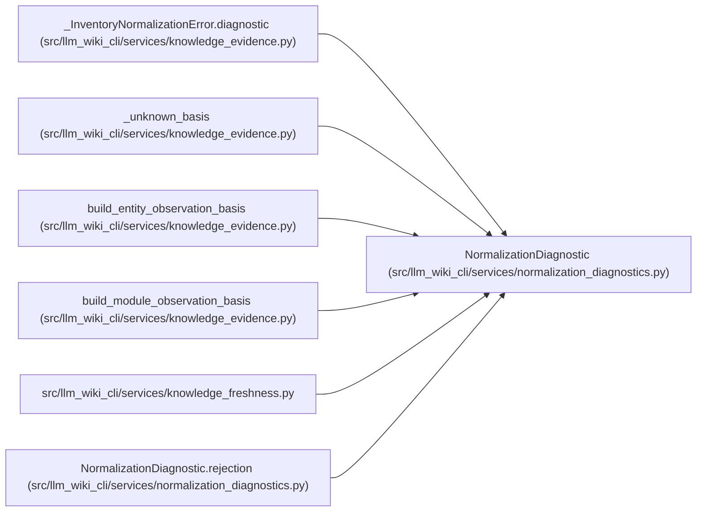

# NormalizationDiagnostic

**Location:** `src/llm_wiki_cli/services/normalization_diagnostics.py:41`
**Kind:** Class
**Bases:** —
**Module:** [normalization_diagnostics](../modules/normalization_diagnostics.md)

**Decorators:** `@dataclass(frozen=True)`

## Description

Immutable fresh-rejection detail with bounded rendering and explicit source,
scope, extractor and entity occurrence coordinates. It contains shape summaries
instead of rejected values. Unknown locations remain null; redacted or truncated
coordinates cannot claim an exact pointer. Its versioned payload is carried in
existing diagnostic text, with the standalone schema shipped in installations.

The evidence and freshness builders retain this only as non-comparing service
state. Persisted basis payloads omit it, so a later historical read cannot invent
the old rejected record or treat a fresh observation as a committed repair.

## Attributes

| Name | Type | Default | Description |
|------|------|---------|-------------|
| `reason` | `str` | *required* | — |
| `pointer` | `str \| None` | *required* | — |
| `rule` | `str` | *required* | — |
| `expected` | `str` | *required* | — |
| `actual_type` | `str` | *required* | — |
| `actual_summary` | `str` | *required* | — |
| `pointer_exact` | `bool` | `True` | — |
| `source_path` | `str \| None` | `None` | — |
| `scope` | `str \| None` | `None` | — |
| `extractor_ref` | `str \| None` | `None` | — |
| `entity_name` | `str \| None` | `None` | — |
| `occurrence` | `int \| None` | `None` | — |

## Methods

| Method | Signature | Decorators | Description |
|--------|-----------|------------|-------------|
| `rejection` | `(reason, pointer, rule, expected, value, *, exact = True)` | `@classmethod` | — |
| `at_source` | `(source_path, scope, extractor_ref, entity_name = None, occurrence = None)` | — | — |
| `to_payload` | `() -> dict` | — | — |
| `render` | `() -> str` | — | — |

## Relationships

<!-- Auto-generated relationship summary. Do not edit by hand. -->

### Summary

| Module | Methods | Attributes |
|---|---:|---|
| [normalization_diagnostics](../modules/normalization_diagnostics.md) | 4 | `actual_summary`, `actual_type`, `entity_name`, `expected`, `extractor_ref`, `occurrence`, `pointer`, `pointer_exact`, `reason`, `rule`, `scope`, `source_path` |

### References

| Reference | Kind | Source | Call sites |
|---|---|---|---:|
| `_InventoryNormalizationError.diagnostic` | type_reference | [knowledge_evidence](../modules/knowledge_evidence.md) | — |
| `_unknown_basis` | type_reference | [knowledge_evidence](../modules/knowledge_evidence.md) | — |
| `build_entity_observation_basis` | call | [knowledge_evidence](../modules/knowledge_evidence.md) | 1 |
| `build_module_observation_basis` | call | [knowledge_evidence](../modules/knowledge_evidence.md) | 1 |
| `knowledge_freshness` | import | [knowledge_freshness](../modules/knowledge_freshness.md) | — |
| `NormalizationDiagnostic.rejection` | call | [normalization_diagnostics](../modules/normalization_diagnostics.md) | 1 |
