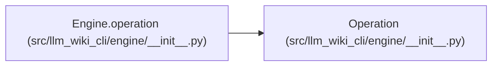

# Operation

**Location:** `src/llm_wiki_cli/engine/__init__.py:251`
**Kind:** Class
**Bases:** —
**Module:** [engine___init__](../modules/engine___init__.md)

**Decorators:** `@dataclass(frozen=True)`

## Description

The settings in force for one engine call and everything beneath it.

## Attributes

| Name | Type | Default | Description |
|------|------|---------|-------------|
| `host` | `Host` | *required* | — |
| `helper_preparation` | `HelperPreparation` | *required* | — |
| `helper_cache_dir` | `str \| None` | *required* | — |
| `comparison_policy` | `str` | *required* | — |
| `validators` | `ValidatorRegistry` | `DEFAULT_VALIDATORS` | — |
| `kinds` | `KindRegistry` | `DEFAULT_KINDS` | — |
| `pack` | `DomainPack` | `CODE_DOCS_PACK` | — |
| `publication_targets` | `PublicationTargetRegistry` | `DEFAULT_PUBLICATION_TARGETS` | — |
| `integrations` | `IntegrationSet` | `DEFAULT_INTEGRATIONS` | — |

## Methods

*No declared methods.*

## Relationships

<!-- Auto-generated relationship summary. Do not edit by hand. -->

### Summary

| Module | Methods | Attributes |
|---|---:|---|
| [engine___init__](../modules/engine___init__.md) | 0 | `comparison_policy`, `helper_cache_dir`, `helper_preparation`, `host`, `integrations`, `kinds`, `pack`, `publication_targets`, `validators` |

### References

| Reference | Kind | Source | Call sites |
|---|---|---|---:|
| `Engine.operation` | call | [engine___init__](../modules/engine___init__.md) | 1 |
| `Engine.operation` | type_reference | [engine___init__](../modules/engine___init__.md) | — |
