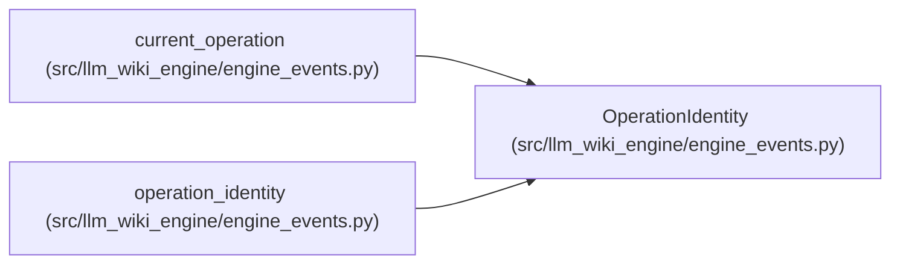

# OperationIdentity

**Location:** `src/llm_wiki_engine/engine_events.py:167`
**Kind:** Class
**Bases:** —
**Module:** [engine_events](../modules/engine_events.md)

**Decorators:** `@dataclass(frozen=True)`

## Description

Names the engine operation that events are reported for.

## Attributes

| Name | Type | Default | Description |
|------|------|---------|-------------|
| `name` | `str` | *required* | — |
| `operation_id` | `str` | *required* | — |

## Methods

*No declared methods.*

## Relationships

<!-- Auto-generated relationship summary. Do not edit by hand. -->

### Summary

| Module | Methods | Attributes |
|---|---:|---|
| [engine_events](../modules/engine_events.md) | 0 | `name`, `operation_id` |

### References

| Reference | Kind | Source | Call sites |
|---|---|---|---:|
| `current_operation` | type_reference | [engine_events](../modules/engine_events.md) | — |
| `operation_identity` | call | [engine_events](../modules/engine_events.md) | 1 |
| `operation_identity` | type_reference | [engine_events](../modules/engine_events.md) | — |
