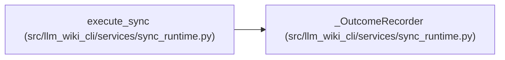

# _OutcomeRecorder

**Location:** `src/llm_wiki_cli/services/sync_runtime.py:282`
**Kind:** Class
**Bases:** —
**Module:** [sync_runtime](../modules/sync_runtime.md)

**Decorators:** `@dataclass`

## Description

_Auto-generated from `_OutcomeRecorder` in `src/llm_wiki_cli/services/sync_runtime.py`._

## Attributes

| Name | Type | Default | Description |
|------|------|---------|-------------|
| `status` | `SyncStatus` | `'no-change'` | — |
| `result` | `'SyncResult \| None'` | `None` | — |
| `storage_cleanup` | `dict \| None` | `None` | — |

## Methods

*No declared methods.*

## Relationships

<!-- Auto-generated relationship summary. Do not edit by hand. -->

### Summary

| Module | Methods | Attributes |
|---|---:|---|
| [sync_runtime](../modules/sync_runtime.md) | 0 | `result`, `status`, `storage_cleanup` |

### References

| Reference | Kind | Source | Call sites |
|---|---|---|---:|
| `execute_sync` | call | [sync_runtime](../modules/sync_runtime.md) | 1 |
