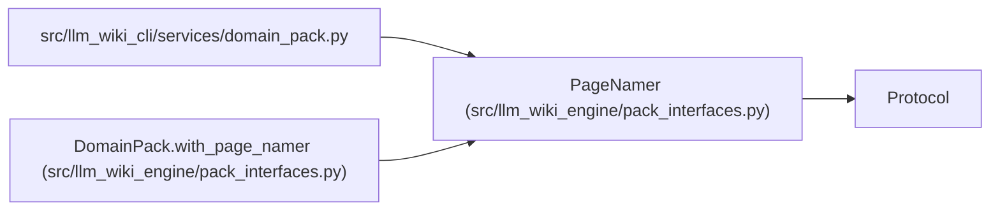

# PageNamer

**Location:** `src/llm_wiki_engine/pack_interfaces.py:62`
**Kind:** Class
**Bases:** `Protocol`
**Module:** [pack_interfaces](../modules/pack_interfaces.md)

**Decorators:** `@runtime_checkable`

## Description

Names the generated module and entity pages for an inventory.

## Attributes

*No annotated attributes found.*

## Methods

| Method | Signature | Decorators | Description |
|--------|-----------|------------|-------------|
| `module_pages` | `(inventory: Mapping[str, Mapping[str, Any]]) -> dict[str, str]` | — | Return ``{source path: module page name}`` for every inventory source. |
| `entity_pages` | `(inventory: Mapping[str, Mapping[str, Any]], module_pages: Mapping[str, str]) -> dict[EntityOccurrenceKey, str]` | — | Return ``{(name, source path, occurrence): entity page name}``. |

## Relationships

<!-- Auto-generated relationship summary. Do not edit by hand. -->

### Summary

| Module | Methods | Attributes |
|---|---:|---|
| [pack_interfaces](../modules/pack_interfaces.md) | 2 | — |

### Structure

| Kind | Entity | Module |
|---|---|---|
| Base | `Protocol` | — |

### References

| Reference | Kind | Source | Call sites |
|---|---|---|---:|
| `domain_pack` | import | [domain_pack](../modules/domain_pack.md) | — |
| `DomainPack.with_page_namer` | type_reference | [pack_interfaces](../modules/pack_interfaces.md) | — |
