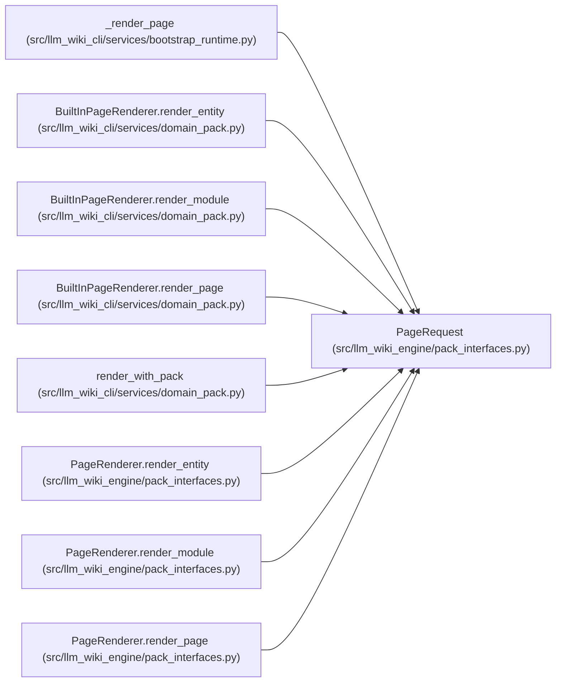

# PageRequest

**Location:** `src/llm_wiki_engine/pack_interfaces.py:123`
**Kind:** Class
**Bases:** —
**Module:** [pack_interfaces](../modules/pack_interfaces.md)

**Decorators:** `@dataclass(frozen=True)`

## Description

Everything a renderer gets for one page that is not a module or entity.

``inputs`` holds what the built-in page is generated from, by name:

* ``index``: ``entity_names``, ``module_entries``, ``workflow_entries``,
  ``guide_entries``, ``infra_entries``, ``flow_entries``,
  ``architecture_entries``, ``retired_entity_pages``,
  ``api_contracts_present``, ``log_present``;
* ``workflows``: ``name``, ``workflow``, ``module_pages``;
* ``flows``: ``flow``, ``module_pages``, ``data_flow``,
  ``diagram_style``, ``api_contract_operations``;
* ``infrastructure``: ``source_path``, ``info``, ``module_links``,
  ``unsupported_sources``;
* ``api-contracts``: ``contracts``, ``module_pages``, ``entity_pages``;
* ``dependencies``: ``analysis``, ``module_pages``, ``detail``,
  ``diagram_style``;
* ``load-order``: ``analysis``, ``module_pages``.

Absent optional inputs are ``None``.

## Attributes

| Name | Type | Default | Description |
|------|------|---------|-------------|
| `page_kind` | `PageKind` | *required* | — |
| `inputs` | `Mapping[str, Any]` | *required* | — |
| `_builtin` | `Callable[[], str]` | `field(repr=False, compare=False)` | — |

## Methods

| Method | Signature | Decorators | Description |
|--------|-----------|------------|-------------|
| `__post_init__` | `() -> None` | — | — |
| `builtin_markdown` | `() -> str` | — | The Markdown the built-in renderer writes for this page. |

## Relationships

<!-- Auto-generated relationship summary. Do not edit by hand. -->

### Summary

| Module | Methods | Attributes |
|---|---:|---|
| [pack_interfaces](../modules/pack_interfaces.md) | 2 | `_builtin`, `inputs`, `page_kind` |

### References

| Reference | Kind | Source | Call sites |
|---|---|---|---:|
| `_render_page` | call | [bootstrap_runtime](../modules/bootstrap_runtime.md) | 1 |
| `BuiltInPageRenderer.render_entity` | type_reference | [domain_pack](../modules/domain_pack.md) | — |
| `BuiltInPageRenderer.render_module` | type_reference | [domain_pack](../modules/domain_pack.md) | — |
| `BuiltInPageRenderer.render_page` | type_reference | [domain_pack](../modules/domain_pack.md) | — |
| `render_with_pack` | type_reference | [domain_pack](../modules/domain_pack.md) | — |
| `PageRenderer.render_entity` | type_reference | [pack_interfaces](../modules/pack_interfaces.md) | — |
| `PageRenderer.render_module` | type_reference | [pack_interfaces](../modules/pack_interfaces.md) | — |
| `PageRenderer.render_page` | type_reference | [pack_interfaces](../modules/pack_interfaces.md) | — |
