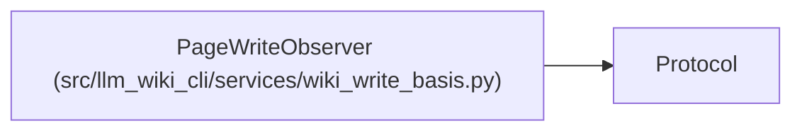

# PageWriteObserver

**Location:** `src/llm_wiki_cli/services/wiki_write_basis.py:22`
**Kind:** Class
**Bases:** `Protocol`
**Module:** [wiki_write_basis](../modules/wiki_write_basis.md)

## Description

Receives before/after write notifications for the active sync. Adopted authority
guards run first; observing a new page never bypasses their compare-and-swap
checks or authorizes replacement of an occupied page.

## Attributes

*No annotated attributes found.*

## Methods

| Method | Signature | Decorators | Description |
|--------|-----------|------------|-------------|
| `before_write` | `(path: Path, content: bytes \| None) -> None` | — | — |
| `after_write` | `(path: Path, content: bytes \| None) -> None` | — | — |

## Relationships

<!-- Auto-generated relationship summary. Do not edit by hand. -->

### Summary

| Module | Methods | Attributes |
|---|---:|---|
| [wiki_write_basis](../modules/wiki_write_basis.md) | 2 | — |

### Structure

| Kind | Entity | Module |
|---|---|---|
| Base | `Protocol` | — |
