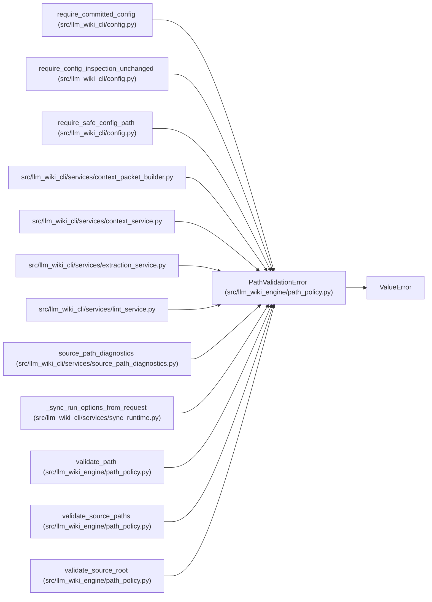

# PathValidationError

**Location:** `src/llm_wiki_engine/path_policy.py:90`
**Kind:** Class
**Bases:** `ValueError`
**Module:** [path_policy](../modules/path_policy.md)

## Description

Raised when a user-provided path escapes the project root.

## Attributes

*No annotated attributes found.*

## Methods

*No declared methods.*

## Relationships

<!-- Auto-generated relationship summary. Do not edit by hand. -->

### Summary

| Module | Methods | Attributes |
|---|---:|---|
| [path_policy](../modules/path_policy.md) | 0 | — |

### Structure

| Kind | Entity | Module |
|---|---|---|
| Base | `ValueError` | — |

### References

| Reference | Kind | Source | Call sites |
|---|---|---|---:|
| `require_committed_config` | call | [config](../modules/config.md) | 1 |
| `require_config_inspection_unchanged` | call | [config](../modules/config.md) | 1 |
| `require_safe_config_path` | call | [config](../modules/config.md) | 2 |
| `context_packet_builder` | import | [context_packet_builder](../modules/context_packet_builder.md) | — |
| `context_service` | import | [context_service](../modules/context_service.md) | — |
| `extraction_service` | import | [extraction_service](../modules/extraction_service.md) | — |
| `lint_service` | import | [lint_service](../modules/lint_service.md) | — |
| `source_path_diagnostics` | call | [source_path_diagnostics](../modules/source_path_diagnostics.md) | 1 |
| `_sync_run_options_from_request` | call | [sync_runtime](../modules/sync_runtime.md) | 1 |
| `validate_path` | call | [path_policy](../modules/path_policy.md) | 2 |
| `validate_source_paths` | call | [path_policy](../modules/path_policy.md) | 1 |
| `validate_source_root` | call | [path_policy](../modules/path_policy.md) | 6 |
