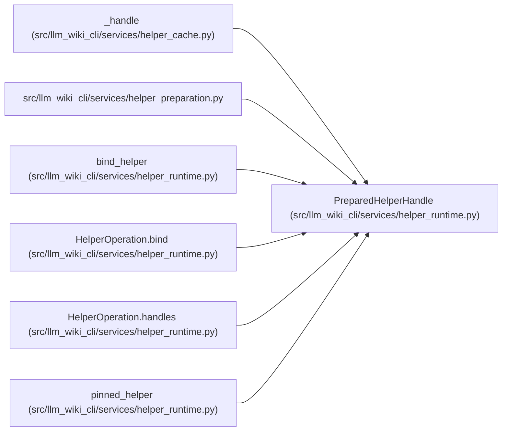

# PreparedHelperHandle

**Location:** `src/llm_wiki_cli/services/helper_runtime.py:57`
**Kind:** Class
**Bases:** —
**Module:** [helper_runtime](../modules/helper_runtime.md)

**Decorators:** `@dataclass(frozen=True)`

## Description

Detached artifact and receipt selected once by the preparation owner.

## Attributes

| Name | Type | Default | Description |
|------|------|---------|-------------|
| `language` | `str` | *required* | — |
| `cache_root` | `Path` | *required* | — |
| `key` | `str` | *required* | — |
| `root` | `Path` | *required* | — |
| `path` | `Path` | *required* | — |
| `receipt` | `Mapping[str, object]` | *required* | — |
| `runtime_executables` | `Mapping[str, str]` | `field(default_factory=dict)` | — |

## Methods

| Method | Signature | Decorators | Description |
|--------|-----------|------------|-------------|
| `__post_init__` | `() -> None` | — | — |

## Relationships

<!-- Auto-generated relationship summary. Do not edit by hand. -->

### Summary

| Module | Methods | Attributes |
|---|---:|---|
| [helper_runtime](../modules/helper_runtime.md) | 1 | `cache_root`, `key`, `language`, `path`, `receipt`, `root`, `runtime_executables` |

### References

| Reference | Kind | Source | Call sites |
|---|---|---|---:|
| `_handle` | call | [helper_cache](../modules/helper_cache.md) | 1 |
| `helper_preparation` | import | [helper_preparation](../modules/helper_preparation.md) | — |
| `bind_helper` | type_reference | [helper_runtime](../modules/helper_runtime.md) | — |
| `HelperOperation.bind` | type_reference | [helper_runtime](../modules/helper_runtime.md) | — |
| `HelperOperation.handles` | type_reference | [helper_runtime](../modules/helper_runtime.md) | — |
| `pinned_helper` | type_reference | [helper_runtime](../modules/helper_runtime.md) | — |
