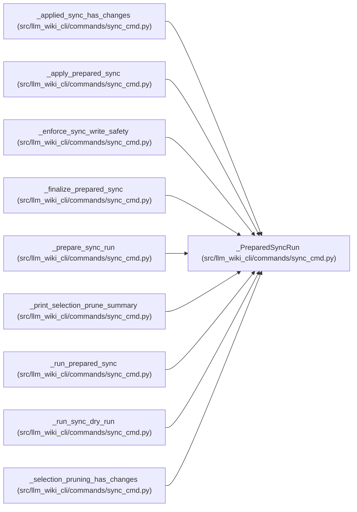

# _PreparedSyncRun

**Location:** `src/llm_wiki_cli/commands/sync_cmd.py:1819`
**Kind:** Class
**Bases:** —
**Module:** [sync_cmd](../modules/sync_cmd.md)

**Decorators:** `@dataclass(frozen=True)`

## Description

Immutable handoff from sync preparation to safety checks and application. It
keeps the validated manifest, live inventory and source snapshot, public and
application diffs, canonical page maps, optional-surface and infrastructure
plans, graph observations, and the flags that distinguish seeding, repair, or a
runtime-basis refresh. Keeping this state together prevents later steps from
recomputing against a different source tree.

`prior_generator_version` retains the version from the validated prior
projection so refusal and preview can explain a generator transition without
reloading authority. Missing provenance stays explicit. A version label is not
an artifact identity and does not refresh captured evidence.

`evidence_refresh_sources` records unchanged sources whose captured invalid
module/entity basis now normalizes successfully. It prevents the unchanged
knowledge shortcut, drives an apply-only refresh and preserves the distinction
between evidence repair and real source edits. Those inputs still count toward
ordinary broad-update review; the flag grants no force or recovery authority.

Carries a coherent full source/inventory plan and its page transitions through
application and publication. A scoped repair retains the original global inputs
inside its repair boundary while filtering only the evidence-refresh application
and recreating transitions for that subset. Global reconciliation is still
validated against the complete prior snapshot before publication.

## Attributes

| Name | Type | Default | Description |
|------|------|---------|-------------|
| `manifest` | `'SyncManifest'` | *required* | — |
| `seed_manifest` | `bool` | *required* | — |
| `repair_only` | `bool` | *required* | — |
| `inventory_result` | `InventoryResult` | *required* | — |
| `source_snapshot` | `SourceSnapshot` | *required* | — |
| `inventory` | `dict` | *required* | — |
| `page_maps` | `_SyncPageMaps` | *required* | — |
| `diff` | `'SyncDiff'` | *required* | — |
| `application_diff` | `'SyncDiff'` | *required* | — |
| `surface_plan` | `_SurfaceInitializationPlan` | *required* | — |
| `repository_evidence` | `RepositoryEvidence` | *required* | — |
| `graph_observations` | `_RuntimeGraphObservations` | *required* | — |
| `infrastructure_plan` | `InfrastructureSyncPlan` | *required* | — |
| `source_selection_prune` | `SourceSelectionPruneResult` | *required* | — |
| `runtime_provenance_changed` | `bool` | *required* | — |
| `generator_refresh_required` | `bool` | *required* | — |
| `runtime_basis_refresh` | `bool` | *required* | — |
| `log_missing` | `bool` | *required* | — |
| `prior_generator_version` | `str \| None` | `None` | — |
| `evidence_refresh_sources` | `tuple[str, ...]` | `()` | — |
| `committed_state` | `CommittedKnowledgeState \| None` | `None` | — |
| `reuse_observations_hash` | `str \| None` | `None` | — |
| `entrypoint_analysis` | `_SyncEntryPointAnalysis \| None` | `None` | — |
| `contracts` | `dict \| None` | `None` | — |
| `analysis_reused` | `bool` | `False` | — |
| `analysis_input_key` | `dict \| None` | `None` | — |
| `page_transitions` | `PageTransitionPlan \| None` | `None` | — |
| `transition_execution` | `PageTransitionExecution \| None` | `None` | — |
| `repair_boundary` | `ScopedRepairBoundary \| None` | `None` | — |

## Methods

*No public methods. Inherits from base classes.*

## Relationships

<!-- Auto-generated relationship summary. Do not edit by hand. -->

### Summary

| Module | Methods | Attributes |
|---|---:|---|
| [sync_cmd](../modules/sync_cmd.md) | 0 | `analysis_input_key`, `analysis_reused`, `application_diff`, `committed_state`, `contracts`, `diff`, `entrypoint_analysis`, `evidence_refresh_sources`, `generator_refresh_required`, `graph_observations`, `infrastructure_plan`, `inventory` |

### References

| Reference | Kind | Source | Call sites |
|---|---|---|---:|
| `_applied_sync_has_changes` | type_reference | [sync_cmd](../modules/sync_cmd.md) | — |
| `_apply_prepared_sync` | type_reference | [sync_cmd](../modules/sync_cmd.md) | — |
| `_enforce_sync_write_safety` | type_reference | [sync_cmd](../modules/sync_cmd.md) | — |
| `_finalize_prepared_sync` | type_reference | [sync_cmd](../modules/sync_cmd.md) | — |
| `_prepare_sync_run` | call | [sync_cmd](../modules/sync_cmd.md) | 1 |
| `_prepare_sync_run` | type_reference | [sync_cmd](../modules/sync_cmd.md) | — |
| `_print_selection_prune_summary` | type_reference | [sync_cmd](../modules/sync_cmd.md) | — |
| `_run_prepared_sync` | type_reference | [sync_cmd](../modules/sync_cmd.md) | — |
| `_run_sync_dry_run` | type_reference | [sync_cmd](../modules/sync_cmd.md) | — |
| `_selection_pruning_has_changes` | type_reference | [sync_cmd](../modules/sync_cmd.md) | — |
