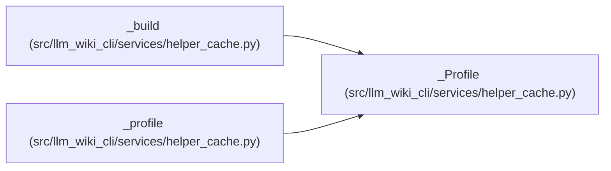

# _Profile

**Location:** `src/llm_wiki_cli/services/helper_cache.py:410`
**Kind:** Class
**Bases:** —
**Module:** [helper_cache](../modules/helper_cache.md)

**Decorators:** `@dataclass(frozen=True)`

## Description

_Auto-generated from `_Profile` in `src/llm_wiki_cli/services/helper_cache.py`._

## Attributes

| Name | Type | Default | Description |
|------|------|---------|-------------|
| `identity` | `dict` | *required* | — |
| `executables` | `dict[str, str]` | *required* | — |
| `environment` | `dict[str, str]` | *required* | — |

## Methods

*No declared methods.*

## Relationships

<!-- Auto-generated relationship summary. Do not edit by hand. -->

### Summary

| Module | Methods | Attributes |
|---|---:|---|
| [helper_cache](../modules/helper_cache.md) | 0 | `environment`, `executables`, `identity` |

### References

| Reference | Kind | Source | Call sites |
|---|---|---|---:|
| `_build` | type_reference | [helper_cache](../modules/helper_cache.md) | — |
| `_profile` | call | [helper_cache](../modules/helper_cache.md) | 1 |
| `_profile` | type_reference | [helper_cache](../modules/helper_cache.md) | — |
