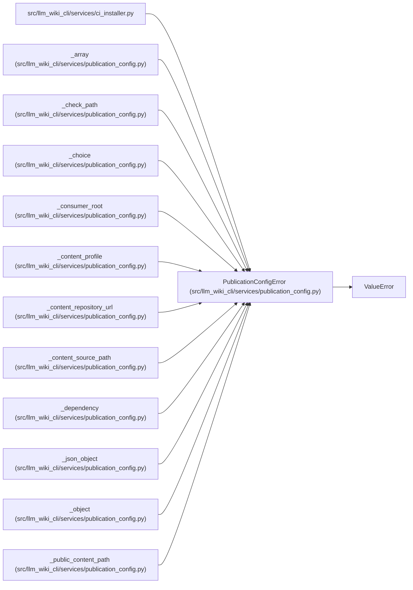

# PublicationConfigError

**Location:** `src/llm_wiki_cli/services/publication_config.py:79`
**Kind:** Class
**Bases:** `ValueError`
**Module:** [publication_config](../modules/publication_config.md)

## Description

A field-specific failure in consumer-owned publication configuration.

## Attributes

*No annotated attributes found.*

## Methods

| Method | Signature | Decorators | Description |
|--------|-----------|------------|-------------|
| `__init__` | `(field: str, message: str)` | — | — |

## Relationships

<!-- Auto-generated relationship summary. Do not edit by hand. -->

### Summary

| Module | Methods | Attributes |
|---|---:|---|
| [publication_config](../modules/publication_config.md) | 1 | — |

### Structure

| Kind | Entity | Module |
|---|---|---|
| Base | `ValueError` | — |

### References

| Reference | Kind | Source | Call sites |
|---|---|---|---:|
| `ci_installer` | import | [ci_installer](../modules/ci_installer.md) | — |
| `_array` | call | [publication_config](../modules/publication_config.md) | 1 |
| `_check_path` | call | [publication_config](../modules/publication_config.md) | 2 |
| `_choice` | call | [publication_config](../modules/publication_config.md) | 1 |
| `_consumer_root` | call | [publication_config](../modules/publication_config.md) | 3 |
| `_content_profile` | call | [publication_config](../modules/publication_config.md) | 9 |
| `_content_repository_url` | call | [publication_config](../modules/publication_config.md) | 1 |
| `_content_source_path` | call | [publication_config](../modules/publication_config.md) | 3 |
| `_dependency` | call | [publication_config](../modules/publication_config.md) | 8 |
| `_json_object` | call | [publication_config](../modules/publication_config.md) | 1 |
| `_object` | call | [publication_config](../modules/publication_config.md) | 2 |
| `_public_content_path` | call | [publication_config](../modules/publication_config.md) | 2 |

> References: showing 12 of 22 logical references; 10 omitted by the 12-row generated summary limit.
