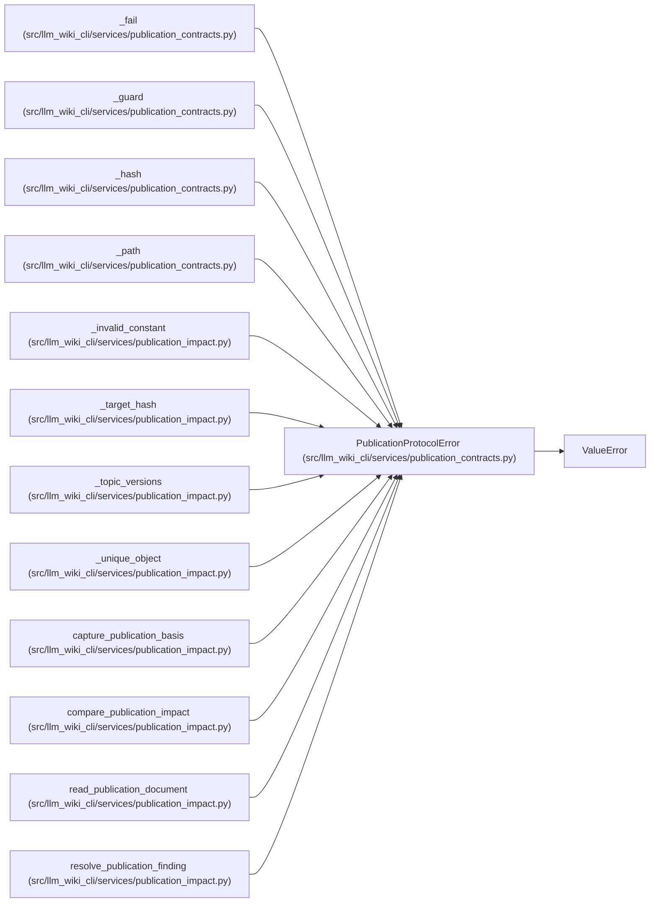

# PublicationProtocolError

**Location:** `src/llm_wiki_cli/services/publication_contracts.py:37`
**Kind:** Class
**Bases:** `ValueError`
**Module:** [publication_contracts](../modules/publication_contracts.md)

## Description

An imported publication document violates its versioned contract.

## Attributes

*No annotated attributes found.*

## Methods

*No declared methods.*

## Relationships

<!-- Auto-generated relationship summary. Do not edit by hand. -->

### Summary

| Module | Methods | Attributes |
|---|---:|---|
| [publication_contracts](../modules/publication_contracts.md) | 0 | — |

### Structure

| Kind | Entity | Module |
|---|---|---|
| Base | `ValueError` | — |

### References

| Reference | Kind | Source | Call sites |
|---|---|---|---:|
| `_fail` | call | [publication_contracts](../modules/publication_contracts.md) | 1 |
| `_guard` | call | [publication_contracts](../modules/publication_contracts.md) | 1 |
| `_hash` | call | [publication_contracts](../modules/publication_contracts.md) | 1 |
| `_path` | call | [publication_contracts](../modules/publication_contracts.md) | 1 |
| `_invalid_constant` | call | [publication_impact](../modules/publication_impact.md) | 1 |
| `_target_hash` | call | [publication_impact](../modules/publication_impact.md) | 1 |
| `_topic_versions` | call | [publication_impact](../modules/publication_impact.md) | 1 |
| `_unique_object` | call | [publication_impact](../modules/publication_impact.md) | 1 |
| `capture_publication_basis` | call | [publication_impact](../modules/publication_impact.md) | 5 |
| `compare_publication_impact` | call | [publication_impact](../modules/publication_impact.md) | 2 |
| `read_publication_document` | call | [publication_impact](../modules/publication_impact.md) | 2 |
| `resolve_publication_finding` | call | [publication_impact](../modules/publication_impact.md) | 6 |
