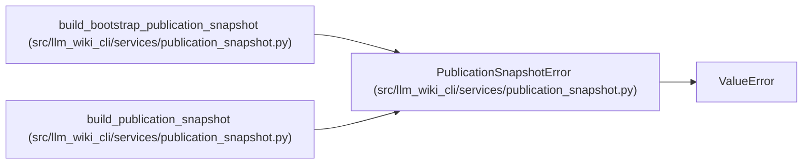

# PublicationSnapshotError

**Location:** `src/llm_wiki_cli/services/publication_snapshot.py:29`
**Kind:** Class
**Bases:** `ValueError`
**Module:** [publication_snapshot](../modules/publication_snapshot.md)

## Description

A complete, coherent publication input could not be established.

## Attributes

*No annotated attributes found.*

## Methods

| Method | Signature | Decorators | Description |
|--------|-----------|------------|-------------|
| `__init__` | `(code: str, message: str) -> None` | — | — |

## Relationships

<!-- Auto-generated relationship summary. Do not edit by hand. -->

### Summary

| Module | Methods | Attributes |
|---|---:|---|
| [publication_snapshot](../modules/publication_snapshot.md) | 1 | — |

### Structure

| Kind | Entity | Module |
|---|---|---|
| Base | `ValueError` | — |

### References

| Reference | Kind | Source | Call sites |
|---|---|---|---:|
| `build_bootstrap_publication_snapshot` | call | [publication_snapshot](../modules/publication_snapshot.md) | 2 |
| `build_publication_snapshot` | call | [publication_snapshot](../modules/publication_snapshot.md) | 1 |
