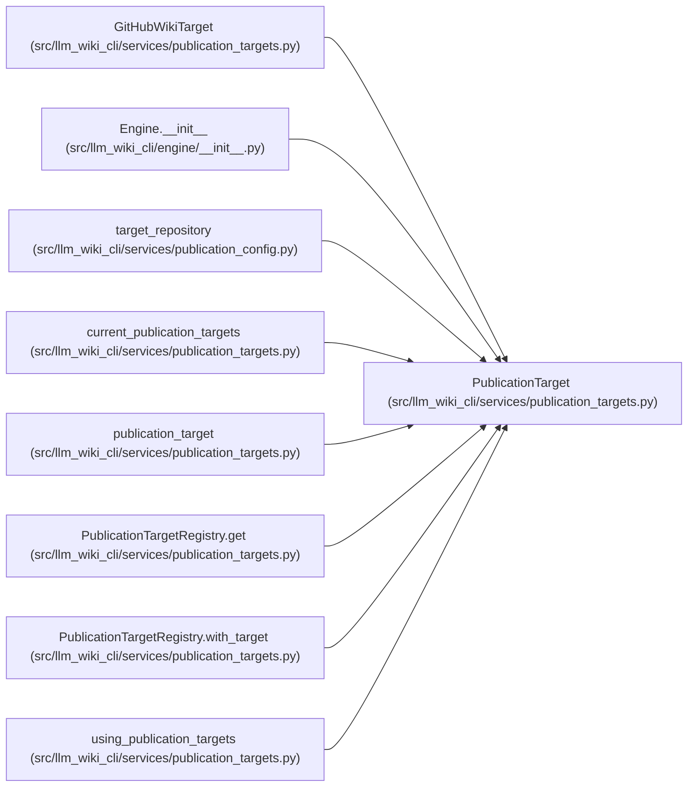

# PublicationTarget

**Location:** `src/llm_wiki_cli/services/publication_targets.py:36`
**Kind:** Class
**Bases:** —
**Module:** [publication_targets](../modules/publication_targets.md)

## Description

The rules of one publication target kind.

Subclasses set :attr:`kind` and implement the three hooks. Hooks must be
deterministic: a candidate is rechecked by running them again.

## Attributes

| Name | Type | Default | Description |
|------|------|---------|-------------|
| `kind` | `str` | `''` | — |

## Methods

| Method | Signature | Decorators | Description |
|--------|-----------|------------|-------------|
| `check_repository` | `(value: object, field: str) -> str` | — | Return ``value`` as a valid repository identifier or raise ``ValueError``. |
| `prepare_page` | `(markdown: str, *, source_path: str, source_pages: Mapping[str, str], source_assets: Mapping[str, str], repository_url: str \| None, source_revision: str \| None) -> str` | — | The published text of authored page ``source_path``. |
| `check` | `(files: Mapping[str, bytes]) -> dict[str, Any]` | — | Check a complete candidate tree. |
| `identity` | `() -> Any` | — | A JSON-ready value that changes whenever this target's output may change. |

## Relationships

<!-- Auto-generated relationship summary. Do not edit by hand. -->

### Summary

| Module | Methods | Attributes |
|---|---:|---|
| [publication_targets](../modules/publication_targets.md) | 4 | `kind` |

### Structure

| Kind | Entity | Module |
|---|---|---|
| Subclass | `GitHubWikiTarget` | [publication_targets](../modules/publication_targets.md) |

### References

| Reference | Kind | Source | Call sites |
|---|---|---|---:|
| `Engine.__init__` | type_reference | [engine___init__](../modules/engine___init__.md) | — |
| `target_repository` | type_reference | [publication_config](../modules/publication_config.md) | — |
| `current_publication_targets` | type_reference | [publication_targets](../modules/publication_targets.md) | — |
| `publication_target` | type_reference | [publication_targets](../modules/publication_targets.md) | — |
| `PublicationTargetRegistry.get` | type_reference | [publication_targets](../modules/publication_targets.md) | — |
| `PublicationTargetRegistry.with_target` | type_reference | [publication_targets](../modules/publication_targets.md) | — |
| `using_publication_targets` | type_reference | [publication_targets](../modules/publication_targets.md) | — |
