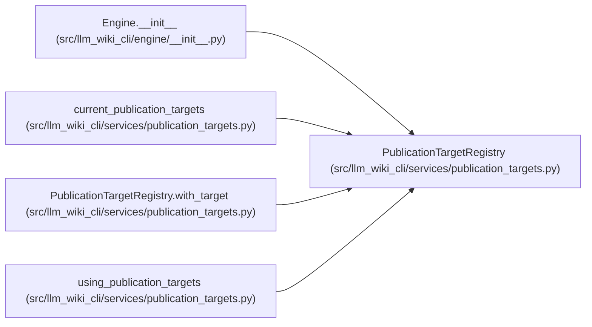

# PublicationTargetRegistry

**Location:** `src/llm_wiki_cli/services/publication_targets.py:121`
**Kind:** Class
**Bases:** —
**Module:** [publication_targets](../modules/publication_targets.md)

**Decorators:** `@dataclass(frozen=True)`

## Description

The publication targets a policy may name, keyed by ``target.kind``.

## Attributes

| Name | Type | Default | Description |
|------|------|---------|-------------|
| `targets` | `tuple[PublicationTarget, ...]` | `(GITHUB_WIKI_TARGET,)` | — |

## Methods

| Method | Signature | Decorators | Description |
|--------|-----------|------------|-------------|
| `__post_init__` | `() -> None` | — | — |
| `kinds` | `() -> tuple[str, ...]` | `@property` | — |
| `get` | `(kind: str) -> PublicationTarget` | — | The target serving ``kind``; ``KeyError`` when none is registered. |
| `with_target` | `(target: PublicationTarget) -> PublicationTargetRegistry` | — | A copy that also serves ``target``, replacing any target of the same kind. |
| `describe` | `() -> dict[str, Any]` | — | A JSON-ready summary of the registered kinds. |
| `identity` | `() -> Any` | — | ``None`` for the built-in targets, else a value naming every target. |

## Relationships

<!-- Auto-generated relationship summary. Do not edit by hand. -->

### Summary

| Module | Methods | Attributes |
|---|---:|---|
| [publication_targets](../modules/publication_targets.md) | 6 | `targets` |

### References

| Reference | Kind | Source | Call sites |
|---|---|---|---:|
| `Engine.__init__` | type_reference | [engine___init__](../modules/engine___init__.md) | — |
| `current_publication_targets` | type_reference | [publication_targets](../modules/publication_targets.md) | — |
| `PublicationTargetRegistry.with_target` | type_reference | [publication_targets](../modules/publication_targets.md) | — |
| `using_publication_targets` | type_reference | [publication_targets](../modules/publication_targets.md) | — |
