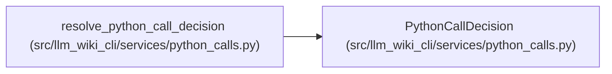

# PythonCallDecision

**Location:** `src/llm_wiki_cli/services/python_calls.py:29`
**Kind:** Class
**Bases:** —
**Module:** [python_calls](../modules/python_calls.md)

**Decorators:** `@dataclass(frozen=True)`

## Description

_Auto-generated from `PythonCallDecision` in `src/llm_wiki_cli/services/python_calls.py`._

## Attributes

| Name | Type | Default | Description |
|------|------|---------|-------------|
| `file` | `str \| None` | *required* | — |
| `symbol` | `str` | *required* | — |
| `kind` | `str` | *required* | — |
| `candidates` | `tuple[Mapping, ...]` | `()` | — |
| `reason` | `str \| None` | `None` | — |
| `location` | `Mapping \| None` | `None` | — |
| `constructor` | `Mapping \| None` | `None` | — |

## Methods

| Method | Signature | Decorators | Description |
|--------|-----------|------------|-------------|
| `__post_init__` | `()` | — | — |
| `as_tuple` | `()` | — | — |
| `metadata` | `()` | — | — |

## Relationships

<!-- Auto-generated relationship summary. Do not edit by hand. -->

### Summary

| Module | Methods | Attributes |
|---|---:|---|
| [python_calls](../modules/python_calls.md) | 3 | `candidates`, `constructor`, `file`, `kind`, `location`, `reason`, `symbol` |

### References

| Reference | Kind | Source | Call sites |
|---|---|---|---:|
| `resolve_python_call_decision` | call | [python_calls](../modules/python_calls.md) | 5 |
| `resolve_python_call_decision` | type_reference | [python_calls](../modules/python_calls.md) | — |
