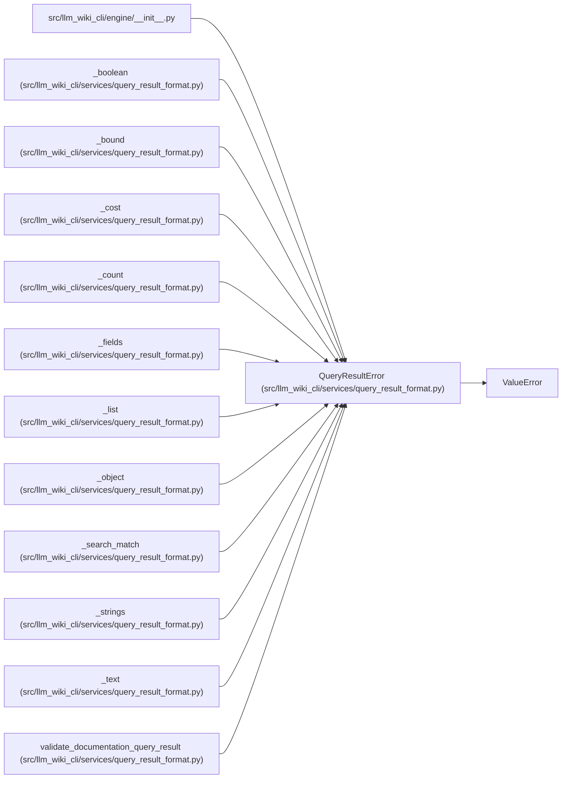

# QueryResultError

**Location:** `src/llm_wiki_cli/services/query_result_format.py:90`
**Kind:** Class
**Bases:** `ValueError`
**Module:** [query_result_format](../modules/query_result_format.md)

## Description

A documentation query or search result does not follow its format.

## Attributes

*No annotated attributes found.*

## Methods

*No declared methods.*

## Relationships

<!-- Auto-generated relationship summary. Do not edit by hand. -->

### Summary

| Module | Methods | Attributes |
|---|---:|---|
| [query_result_format](../modules/query_result_format.md) | 0 | — |

### Structure

| Kind | Entity | Module |
|---|---|---|
| Base | `ValueError` | — |

### References

| Reference | Kind | Source | Call sites |
|---|---|---|---:|
| `__init__` | import | [engine___init__](../modules/engine___init__.md) | — |
| `_boolean` | call | [query_result_format](../modules/query_result_format.md) | 1 |
| `_bound` | call | [query_result_format](../modules/query_result_format.md) | 2 |
| `_cost` | call | [query_result_format](../modules/query_result_format.md) | 2 |
| `_count` | call | [query_result_format](../modules/query_result_format.md) | 1 |
| `_fields` | call | [query_result_format](../modules/query_result_format.md) | 2 |
| `_list` | call | [query_result_format](../modules/query_result_format.md) | 1 |
| `_object` | call | [query_result_format](../modules/query_result_format.md) | 1 |
| `_search_match` | call | [query_result_format](../modules/query_result_format.md) | 3 |
| `_strings` | call | [query_result_format](../modules/query_result_format.md) | 1 |
| `_text` | call | [query_result_format](../modules/query_result_format.md) | 1 |
| `validate_documentation_query_result` | call | [query_result_format](../modules/query_result_format.md) | 8 |

> References: showing 12 of 13 logical references; 1 omitted by the 12-row generated summary limit.
