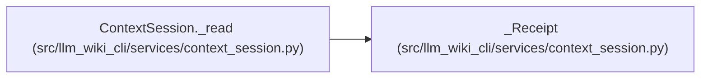

# _Receipt

**Location:** `src/llm_wiki_cli/services/context_session.py:166`
**Kind:** Class
**Bases:** —
**Module:** [context_session](../modules/context_session.md)

**Decorators:** `@dataclass(frozen=True)`

## Description

_Auto-generated from `_Receipt` in `src/llm_wiki_cli/services/context_session.py`._

## Attributes

| Name | Type | Default | Description |
|------|------|---------|-------------|
| `entry` | `_Entry` | *required* | — |
| `request` | `Mapping[str, Any]` | *required* | — |
| `options` | `Mapping[str, Any]` | *required* | — |
| `view` | `CompactTaskContext` | *required* | — |

## Methods

*No declared methods.*

## Relationships

<!-- Auto-generated relationship summary. Do not edit by hand. -->

### Summary

| Module | Methods | Attributes |
|---|---:|---|
| [context_session](../modules/context_session.md) | 0 | `entry`, `options`, `request`, `view` |

### References

| Reference | Kind | Source | Call sites |
|---|---|---|---:|
| `ContextSession._read` | call | [context_session](../modules/context_session.md) | 1 |
