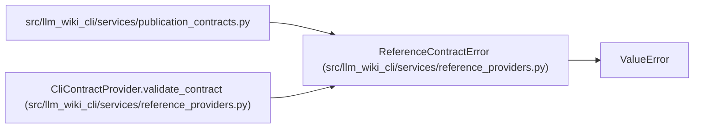

# ReferenceContractError

**Location:** `src/llm_wiki_cli/services/reference_providers.py:49`
**Kind:** Class
**Bases:** `ValueError`
**Module:** [reference_providers](../modules/reference_providers.md)

## Description

A stored contract could not have come from its provider.

## Attributes

*No annotated attributes found.*

## Methods

*No declared methods.*

## Relationships

<!-- Auto-generated relationship summary. Do not edit by hand. -->

### Summary

| Module | Methods | Attributes |
|---|---:|---|
| [reference_providers](../modules/reference_providers.md) | 0 | — |

### Structure

| Kind | Entity | Module |
|---|---|---|
| Base | `ValueError` | — |

### References

| Reference | Kind | Source | Call sites |
|---|---|---|---:|
| `publication_contracts` | import | [publication_contracts](../modules/publication_contracts.md) | — |
| `CliContractProvider.validate_contract` | call | [reference_providers](../modules/reference_providers.md) | 1 |
